# Feature Parity Plan — Variante B (`fabulousFunnel.mkv`) · revisión v2

| | |
|---|---|
| **Referencia** | Funnel web de onboarding de *Fabulous*, grabación `fabulousFunnel.mkv` (8:52): Biblioteca de anuncios de Meta → quiz → "Pay what you want" → hoja de plan con descuento y pago |
| **A construir** | **Bloom** — este repo |
| **Relación con los otros documentos** | Complementa [`PLAN.md`](PLAN.md) (variante A, grabación `2026-10-29 01-53-06.mkv`). El quiz es el mismo; **cambia el cierre** (§4). Índice: [`README.md`](README.md) |
| **Datos máquina-legibles** | [`funnel.variant-b.reference.json`](funnel.variant-b.reference.json) · tracker: [`PARITY_STATUS.md`](PARITY_STATUS.md) · decisiones: [`DECISIONS.md`](DECISIONS.md) |
| **Imágenes** | [`images/b-*.png`](images/) (26 PNG; las de la variante A son `images/00…19-*.png`) |
| **Estado del repo (2026-11-02)** | Variante A implementada (fases 0–7 y 9) y **variante B implementada (fases B0–B8, rama `v2`)** con los guardrails v2, incluida la fase B1 que reabrió el quiz compartido. Evidencia por paso en [`PARITY_STATUS.md`](PARITY_STATUS.md); decisiones `I-43` a `I-62` en [`DECISIONS.md`](DECISIONS.md). Lo que el video no permite saber sigue en §9.2 |
| **Fecha / autor** | 2026-11-02 · revisión v2: el video se recorrió de nuevo completo y se aplican los guardrails v2 |

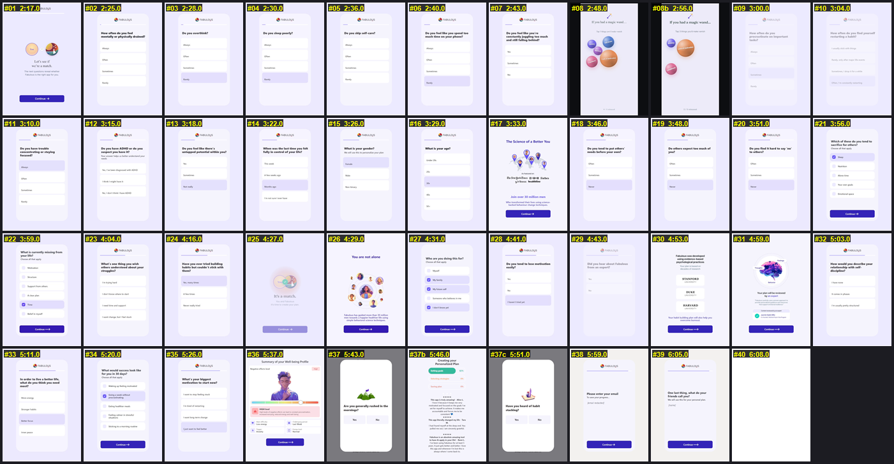

*Quiz (2:17 → 6:08). Cada mosaico lleva `#NN` (número de paso, igual que en PLAN.md §3; 08b, 37b y 37c son estados extra) y el minuto del video.*

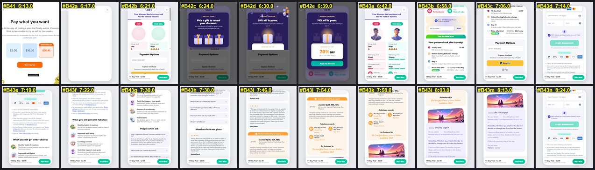

*Cierre (6:13 → 8:24). `B41` = paso #41 (Pay what you want). `B42a…B42e` = hoja cargando y modal del regalo. `B43a…B43n` = posiciones de scroll de la hoja, en orden.*

---

## 0. Léeme primero (para el agente ejecutor)

**Objetivo.** Dejar en Bloom un funnel con **paridad funcional y visual** con la variante B: el mismo quiz de 35 pasos + resumen + loader + email + nombre (ya especificado en `PLAN.md` y **ya implementado**) y un **cierre distinto**: una página *Pay what you want* (tres importes) que abre una **hoja de plan** con descuento por regalo, cuenta regresiva, comparación *NOW vs YOUR GOAL*, pago express/tarjeta, textos legales, beneficios, FAQ, reseñas, experto, premios, prensa y una carta personalizada.

**Paridad significa** mismas pantallas, orden, mecánicas, layout, estados y tiempos de animación, **y el mismo contenido**: bajo los guardrails v2 (§2) se renderizan todos los claims, credenciales y testimonios de la referencia, sustituyendo únicamente el nombre y el logo "Fabulous" por los de Bloom.

**Qué cambia en la v2 respecto de la versión anterior de este plan**

1. **Guardrails v2** (§2): ya no se ocultan claims, credenciales ni testimonios; se borra el atributo `claimRef`. Quedan sin efecto las reglas contrarias de `PLAN.md`, `PLAN-B.md` (versión anterior) y `DECISIONS.md` (lista en §2.3).
2. **Nueva fase B1** (§7): el código ya construido para la variante A oculta esos bloques (`src/funnel/claims.ts`, pantallas #17, #26, #30, #31 y #37). Hay que **reabrirlos** y actualizar sus tests antes de construir el cierre.
3. **Imágenes nuevas** `b-16 … b-19` (§3.4, §4.8, §4.9): las pantallas con claims del quiz tal como se ven en *esta* grabación, el loader con los tres testimonios, la hoja completa en una sola captura y la prueba social ampliada. Todas con email, nombre y foto del revisor redactados.
4. **Inventario de claims** (§3.3) con el texto exacto, y `funnel.variant-b.reference.json` actualizado con ese texto.
5. **Delta con el código actual** (§6.8): qué archivos de `src/` y `tests/` cambian y cuáles se crean.

**Cómo trabajar**

1. Instala dependencias (`npm ci`) y **lee `AGENTS.md`**: esta versión de Next.js tiene cambios incompatibles; antes de escribir código lee la guía relevante en `node_modules/next/dist/docs/`.
2. Lee `README.md`, `PLAN.md` §0–§4 y este documento §1–§3. Revisa lo ya hecho en `src/` (`funnel/`, `screens/`, `pricing/`, `profile/`, `services/`) y las decisiones `I-xx` de `DECISIONS.md`.
3. Ejecuta las fases **B0 → B8** de §7. B1, B2, B3 y B7 son independientes entre sí tras B0 (carpetas distintas); B4, B5 y B6 comparten archivos de la hoja: en serie o por componente.
4. Cada pantalla tiene su sección con imagen anotada (números rojos ↔ leyenda justo debajo), medidas, estados, comportamiento y criterios de aceptación.
5. El copy y los datos de referencia están en `funnel.variant-b.reference.json` (y, para el quiz, en `funnel.reference.json`). `{{brand}}` = Bloom.
6. Lo que el video no muestra se resuelve con el default de §9 y se registra en `DECISIONS.md` (continúa su numeración). Pregunta al usuario sólo por los **bloqueantes** de §9.1.
7. No cierres una fase sin evidencia: lint + tests + build en verde y capturas (§8.2) comparadas con las imágenes. Actualiza `PARITY_STATUS.md`.
8. **No necesitas abrir el video** (`*.mkv`, ignorado por git): todo está en las imágenes y en los JSON. Si lo abres, no copies de él el email, el nombre ni el medio de pago que aparecen (guardrail 7). No lo borres ni lo commitees.

**Prompt de arranque sugerido**

```text
Lee AGENTS.md y docs/feature-parity/README.md; luego docs/feature-parity/PLAN-B.md completo (v2),
PLAN.md secciones 0 a 4, y funnel.reference.json + funnel.variant-b.reference.json.
El quiz y la variante A ya están implementados: revisa src/ y DECISIONS.md antes de escribir nada.
Ejecuta las fases B0 a B8 de PLAN-B.md. Empieza por B0 y B1: B1 reabre las pantallas #17, #26, #30,
#31 y #37 para renderizar los claims, credenciales y testimonios de la referencia (guardrails v2,
PLAN-B.md sec. 2) y actualiza los tests que hoy afirman lo contrario.
Implementa el cierre detrás del flag funnel.closing = 'paywall' | 'pwyw' (por defecto 'pwyw') y el
contador detrás de paywall.countdown.enabled (mismo flag que ya existe; no se reinicia al recargar).
Las imágenes de docs/ son sólo referencia: no las copies a src/ ni a public/ (rehaz logos e
ilustraciones como SVG/CSS propios). No reintroduzcas el email, el nombre ni el medio de pago del video.
No integres pagos reales: MockCheckoutProvider hasta que el usuario resuelva D4 y D9-D15.
Al cerrar cada fase corre lint, typecheck, tests y build, captura pantallas a 1280x720 y compáralas
con docs/feature-parity/images/b-*.png; actualiza PARITY_STATUS.md y DECISIONS.md.
No commitees ni borres los archivos *.mkv/*.mp4/capturas de la raíz del repo.
```

**Definición de terminado (variante B)**

- El recorrido completo funciona con `funnel.closing = 'pwyw'`: quiz → #38 email → #39 nombre → #40 carga → #41 Pay what you want → #42 hoja (carga, regalo, secciones, pago mock) sin errores en consola; y sigue funcionando con `'paywall'`.
- Cada pantalla nueva pasa su checklist de §8.1 y se compara lado a lado con su imagen.
- Todos los claims, credenciales y testimonios del inventario §3.3 se renderizan en su pantalla; no queda ningún `claimRef`, `ClaimRef`, `hasEvidence` ni `claimsProven` en el repo.
- Los guardrails v2 se cumplen (§2.2) con tests que fallan si se rompen (§8.4).
- Lint, typecheck, tests unitarios, e2e (Playwright) y build en verde; accesibilidad básica (§8.3).
- `PARITY_STATUS.md` con evidencia por paso y `DECISIONS.md` con las decisiones tomadas.

---

## 1. Fuente y cobertura

| Dato | Valor |
|---|---|
| Archivo | `fabulousFunnel.mkv` en la raíz del repo (166.9 MB; ignorado por git vía `*.mkv`) |
| Formato | 8:52.7 · 1280×720 · 30 fps constante · H.264 · AAC 48 kHz estéreo |
| Audio | **Silencio digital** (media y pico −91 dB, verificado de nuevo en la v2). No hay narración ni música: todas las instrucciones son visuales |
| Qué muestra | Un recorrido con clics: (1) investigación en la Biblioteca de anuncios de Meta, (2) el funnel completo desde el anuncio, (3) el cierre con *Pay what you want* y la hoja de plan, hasta el bloque de pago |
| Cursor | No se ve; los estados *hover/pressed* se infieren por los resaltados |
| Pausas | Hay esperas del usuario (p. ej. leyendo la hoja, 6:42–8:23). No son parte del diseño |
| Datos personales | La grabación muestra un email, un nombre y, al final, las tarjetas guardadas de Google Pay. En las imágenes están **redactados** (`[email redacted]`, `[name]`, `[photo]` también para la foto del revisor) o excluidos. No intentes reconstruirlos |

### 1.1 Línea de tiempo

| Tramo | Qué se ve | Alcance | Imágenes |
|---|---|---|---|
| 0:00 – 0:20 | Biblioteca de anuncios de Meta: listado de anuncios del anunciante "The Fabulous" | Contexto | b-01 |
| 0:21 – 1:02 | Modal *Filtros*: Idioma (Español + Inglés), Plataforma (Instagram), Tipo de contenido, fechas; Estado: Anuncios activos | Contexto | b-02 |
| 1:02 – 1:05 | Skeleton gris mientras recarga el listado | Contexto | — |
| 1:06 – 1:40 | Scroll por los resultados; hover sobre los CTA (1:31 muestra la URL de destino en la barra de estado) | Contexto | b-04 |
| 1:41 – 2:05 | *Ver detalles del anuncio*: detalle de un anuncio (video estilo tweet reproduciéndose) | Contexto | b-03 |
| 2:05 – 2:09 | Vuelta al listado; hover sobre el CTA del anuncio en inglés (2:08: URL del funnel grabado) | Contexto | b-04 |
| 2:10 – 2:12 | Pantalla en negro (cambio de pestaña) | — | — |
| 2:13 – 2:16 | Se carga el funnel: fondo lavanda → logo → intro | Producto | b-00a |
| 2:17 – 6:08 | Quiz: 35 pasos + resumen + loader + email + nombre | Producto | b-00a, **b-16, b-17** |
| 6:08 – 6:12 | Pantalla en blanco | Producto (no replicar) | b-00a |
| 6:13 – 6:15 | **Pay what you want** | Producto | b-08 |
| 6:16 – 6:20 | La hoja de plan se carga (≈ 4 s) | Producto | b-anim-02 |
| 6:21 – 6:41 | Modal del regalo → descuento → *Apply my discount* | Producto | b-09, b-anim-01 |
| 6:42 – 8:23 | Scroll de la hoja de arriba abajo | Producto | b-10 … b-15, **b-18, b-19** |
| 8:24 – 8:28 | *Start Now* → vuelve al bloque *Payment Options* | Producto | b-12 |
| 8:29 – 8:48 | Clic en Google Pay: lista de tarjetas guardadas y página de administración de pagos de Google | UI de terceros, **sin imágenes** (datos personales) | — |
| 8:49 – 8:52 | Vuelta a *Payment Options*. **El video termina ahí**; no se ve ningún pago completado | — | — |

### 1.2 Zoom y medidas (diferente a la variante A)

A diferencia de la grabación A, **esta no está deformada horizontalmente** (los círculos miden 61×60 px). Está **letterboxed**: barras negras de 64 px arriba y 63 px abajo; el viewport del navegador ocupa `x ≈ 5–1275`, `y ≈ 64–657` (≈ 1270×593). Además se grabó con el **navegador a ≈ 73 % de zoom**: la card del quiz mide 269 px de video frente a ≈ 365–375 px CSS en la variante A.

> **Regla de conversión:** `px CSS ≈ px de video × 1.36` (±3 %). Las medidas de este documento vienen como *px de video → px CSS*. Si prefieres otro ancho de referencia, conserva las **proporciones**.

Los colores se muestrearon de los frames (H.264, ±3 niveles por canal): son tokens de partida. Las imágenes nuevas (`b-16…b-19`) están a escala nativa del video (sin reescalar, salvo `b-19`, ampliada ×1.8 para leer el texto).

### 1.3 Convenciones

- `#NN` = paso del funnel (los 1–40 comparten numeración con `PLAN.md` §3; **#41** y **#42** son nuevos). `[m:ss]` = momento aproximado del video (±1 s).
- **Números rojos** en una imagen ↔ leyenda numerada justo debajo.
- `{{brand}}` = nombre del producto (aquí **Bloom**; en la referencia "Fabulous"). `{{firstName}}`, `{{email}}` = datos capturados en #39/#38. `{{audience}}` = `men | women | people`.

---

## 2. Guardrails (no negociables) — v2

### 2.1 Texto vigente

1. **Marca y assets de terceros.** No copies el nombre/logo "Fabulous".
2. **Claims y credenciales.** Renderiza todos los claims y credenciales.
3. **Testimonios.** Los tres del loader (Alice L., Tara M., Remi L.) son de la referencia. Mostralos.
4. **Suscripción y precios.** Mantén (y hazlo legible) el texto que aclara el precio de renovación y cómo cancelar. Los precios tachados deben corresponder a un precio previo real. El total del checkout debe coincidir siempre con el plan elegido.
5. **Urgencia.** El temporizador "Discount reserved for 15:00" sólo es válido si el descuento realmente vence y no se reinicia al recargar. Impleméntalo detrás de un flag (`paywall.countdown.enabled`).
6. **Imágenes de referencia.** Viven sólo en `docs/`. No las incluyas en el bundle del producto.
7. **Privacidad del material fuente.** No reintroduzcas el email, el nombre ni el medio de pago del video en código, fixtures ni tests.

Son los mismos que `PLAN.md` §2 (commit `a217f24`). Este documento los aplica a la variante B.

### 2.2 Cómo se aplican en la variante B

| # | Regla | Qué significa al implementar | Cómo se comprueba |
|---|---|---|---|
| 1 | Marca | Sustituye **"Fabulous"** (nombre, logo, wordmark y el dominio de la referencia en el texto legal) por `{{brand}}` / el logo de Bloom, también dentro del texto de testimonios, premios y citas (`{{brand}} awards`, `{{brand}} is an absolute amazing tool…`). El resto del copy se conserva literal. Ilustraciones, avatares, íconos 3D y wordmarks de terceros **no se recortan de las imágenes de `docs/`** (regla 6): se rehacen como SVG/CSS/texto propios con el mismo layout | tests que ya existen y se mantienen: `copy` y el CSS no contienen "fabulous" (`tests/unit/funnel/personalize.test.ts`, `tests/unit/tokens.test.ts`); extiéndelos a `claims.ts` y a `copy.variant-b.en.json` |
| 2 | Claims y credenciales | Renderiza todo el inventario de §3.3 (cifras, prensa, universidades, revisor experto, premios, reseñas, el costo del trial). **Borra** `ClaimRef`, `claimRefs`, `hasEvidence`, `claimsProven`, el campo `evidence` y las variantes de copy sin claim. El texto vive en un único módulo (`src/funnel/claims.ts`, ahora un registro de contenido) para poder editarlo en un solo sitio | e2e/unit: cada claim de §3.3 está en su pantalla; `git grep -n claimRef` vacío |
| 3 | Testimonios | El loader (#37) muestra los tres testimonios de §3.3 tal cual (estrellas, título con autor, cuerpo), sustituyendo sólo el nombre de la marca. La hoja muestra las dos reseñas de §3.3 | unit del loader + e2e |
| 4 | Suscripción y precios | (a) El bloque legal (§4.7) es **legible** (≥ 12 px, contraste ≥ 4.5:1) y **cerca del botón de pago** va un resumen del cobro: *"{{trialAmount}} today. Then {{renewalPrice}} every 2 months from {{trialEndDate}} until you cancel. Cancel anytime in your account settings."*. (b) El tachado sólo se muestra si `pricing.afterTrial.listPrice` (precio de lista previo y real) existe; **no lo derives** del porcentaje de descuento. Con precios de demo, etiqueta "Demo prices" como en `I-37`. (c) El importe del trial elegido en #41, el de la barra fija, el del bloque de pago, el legal y el total del `CheckoutProvider` salen **todos** de `trialAmount` | unit de `PricingService` + e2e: elegir $2.00 / $10.00 / $16.41 ⇒ el mismo importe en 4 sitios |
| 5 | Urgencia | El contador (chip de la cabecera, chip del cupón, línea fina y el texto "reserved for the next 15 minutes") sólo existe con `paywall.countdown.enabled` (en el código: `NEXT_PUBLIC_PAYWALL_COUNTDOWN=1`, `src/funnel/flags.ts`). Con el flag apagado la cabecera dice "Your plan is ready" y no hay chip ni línea. Encendido: arranca **al conceder el descuento** (§6.5), se calcula contra `expiresAt` y **no se reinicia al recargar**; al vencer, el descuento deja de aplicarse de verdad | unit de `CountdownService` + e2e (recarga con el contador en marcha) |
| 6 | Imágenes de referencia | Nada de `docs/feature-parity/**` se importa, copia ni referencia desde `src/`, `public/` ni `tests/` (los tests pueden *leer* los JSON de `docs/`, como hoy). No existe `public/` con copias | test `referenceAssets` (§8.4) y revisión de `.next/` tras el build |
| 7 | Privacidad del material fuente | Datos de prueba inventados (`test@example.test`, "Test User"). Las capturas del repo (`npm run shots`) ya siembran un estado demo inventado (`I-25`): no lo cambies por datos reales | test `sourcePrivacy` (§8.4): sin emails con dominios no reservados ni números de tarjeta en `src/`, `tests/`, `scripts/` |

### 2.3 Reglas anteriores que quedan sin efecto

Si un documento o el código contradice §2.1, **gana §2.1**. En concreto dejan de regir:

- `PLAN.md` §5.6 (#17: "sólo con evidencia… suprime el bloque"; #26: "ilustración propia obligatoria" en lo que exija evitar la referencia; #30: "no uses logos de universidades"; #31: "el revisor debe ser real"), §5.8 ("testimonios (propios)"), §6.3 (cifras sólo con evidencia), §7 fases 3 y 5 ("claims bajo flag", "testimonios propios") y §9.1-D3.
- `PLAN-B.md` versión anterior: §2 puntos 1–4, 6, 9 y 11; D10, D11 y D13 de §9.1; el apartado "no se replican" sobre el claim del costo y sobre el regalo como azar.
- `DECISIONS.md`: **D3**, **I-23**, **I-29** y la parte de testimonios de **I-33** (los reemplazan las decisiones que se tomen en B1).
- `funnel.reference.json` y `funnel.variant-b.reference.json`: los atributos `claimRef` y el registro `claimRefs` se eliminan (ya hecho en esta revisión).
- `src/funnel/copy.en.json`: el comentario "Keys ending in 'Claim' are only shown once Bloom has evidence…".

Lo que **no** cambia: `MockCheckoutProvider`, no guardar datos de tarjeta propios, el aviso de privacidad de la pregunta #12 (`I-18`) y la línea "Not a medical assessment" del resumen (`I-32`): no están en los guardrails v2 y tampoco los contradicen.

### 2.4 Riesgos conocidos (para el product owner; no modifican los guardrails)

Mostrar como propios los claims, credenciales y testimonios de otra marca puede constituir publicidad engañosa y uso no autorizado de nombres y marcas si el funnel se publica con cobro real. Dejarlo asentado evita sorpresas:

- **Cifras:** "Join over 30 million men" y "{{brand}} has guided more than 30 million…" afirman una base de usuarios que Bloom no tiene hoy.
- **Prensa, universidades, premios:** The New York Times, WIRED, Forbes, girlboss, healthline, SELF; Stanford, Duke, Harvard; "Best App Finalist", "Best Self-Care App 2018", "Design Award Winner".
- **Revisor experto:** nombre y cargo de una persona real (§3.3-C4). La foto **no** se incluye (avatar genérico).
- **Testimonios:** cinco textos de terceros. El tercero del loader dice "I've been using {{brand}} for at least 5 years" y la primera reseña de la hoja da las gracias a **otro producto** ("Clarify ADHD"), tal como aparecen en la referencia.
- **Costo del trial** ("It costs us $16.41 to compensate our employees…"): afirmación factual sobre la empresa.
- **Regalo y descuento:** se observó un solo resultado (70 %) para el único regalo elegido.

Mitigación incluida: todo el contenido sale de **un solo módulo** (`claims.ts`) y de las claves `claims.*` del copy, así que puede editarse o reemplazarse por datos propios sin tocar los componentes. Recomendación: revisarlo con asesoría legal antes de activar pagos reales (Fase 8).

---

## 3. Mapa del funnel B y diferencias con A

| Pasos | Contenido | Diferencia con A |
|---|---|---|
| Anuncio | URL de entrada con parámetros UTM | Contexto nuevo (§3.1) |
| #01 | Intro | **Titular distinto** (§3.2) |
| #02 – #29, #31 – #35 | Preguntas, wand, intermedias, multi-select | Mismo copy y opciones. *Verificado en la v2*: títulos y opciones de #10, #12, #23, #34 y #35 y los textos de #17, #26, #30, #31 y #37 coinciden con `funnel.reference.json` |
| #30 | Evidencia basada en ciencia | **Frase final distinta** (depende del perfil) |
| #36 | Resumen del perfil | **Valores distintos** (dependen de las respuestas) |
| #37 – #39 | Loader con 2 preguntas y 3 testimonios, email, nombre | Igual |
| #40 | Pantalla en blanco (≈ 4–5 s) | Igual (no replicar) |
| **#41** | **Pay what you want** | **Nuevo** — reemplaza al paywall de 3 planes (`PLAN.md` §5.10) |
| **#42** | **Hoja de plan** + modal del regalo + pago | **Nuevo** — reemplaza al modal de checkout (`PLAN.md` §5.11) |

**Regla global:** el cierre se elige con `funnel.closing = 'pwyw' | 'paywall'`. Los pasos #38–#40, el proveedor de pago y el estado `lead` son compartidos.

### 3.1 Entrada: Biblioteca de anuncios de Meta (contexto, no producto)

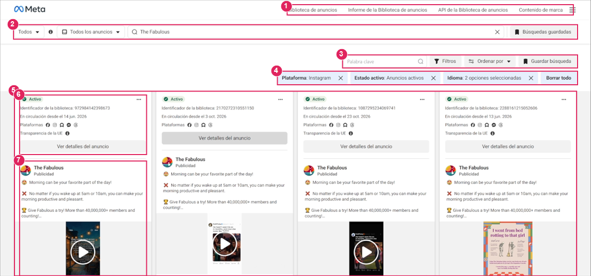

1. Navegación (Biblioteca de anuncios · Informe · API · Contenido de marca).
2. Barra de búsqueda: categoría ("Todos"), tipo ("Todos los anuncios"), campo con el anunciante buscado y "Búsquedas guardadas".
3. Herramientas: palabra clave, *Filtros*, *Ordenar por*, *Guardar búsqueda*.
4. Chips de filtros activos: Plataforma: Instagram · Estado activo: Anuncios activos · Idioma: 2 opciones · *Borrar todo*.
5. Grilla de resultados (4 columnas).
6. Cabecera de cada tarjeta: "Activo", identificador de la biblioteca, "En circulación desde…", plataformas, transparencia UE, *Ver detalles del anuncio*.
7. Anuncio: anunciante + "Publicidad", copy de 3 líneas con emojis y creatividad en video.

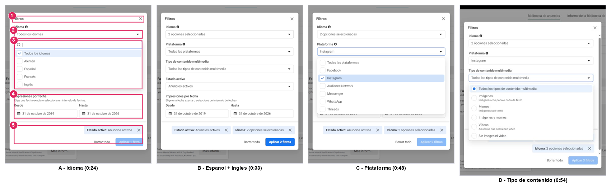

**A** Idioma (lista con casillas: Todos, Alemán, Español, Francés, Inglés). **B** Español + Inglés seleccionados. **C** Plataforma (Facebook, **Instagram ✓**, Audience Network, Messenger, WhatsApp, Threads). **D** Tipo de contenido multimedia (Todos, Imágenes, Memes, Imágenes y memes, Videos, Sin imagen ni video). Leyenda de **A**: 1 cabecera + ×, 2 desplegable de idioma, 3 lista con buscador, 4 *Impresiones por fecha* (31/10/2019 → 31/10/2026), 5 pie con chip, *Borrar todo* y *Aplicar N filtros*.

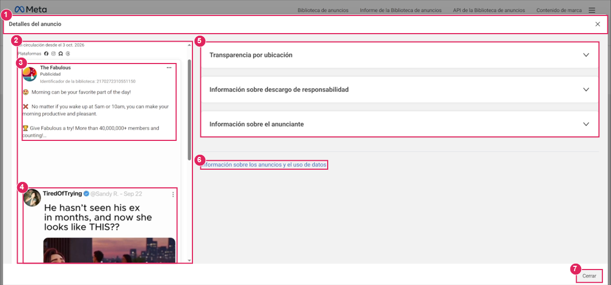

1. Cabecera "Detalles del anuncio" + ×. 2. Columna izquierda con scroll (vigencia y plataformas). 3. Copy del anuncio. 4. Creatividad (captura estilo tweet con video). 5. Acordeones: Transparencia por ubicación · Información sobre descargo de responsabilidad · Información sobre el anunciante. 6. Enlace "Información sobre los anuncios y el uso de datos". 7. *Cerrar*.

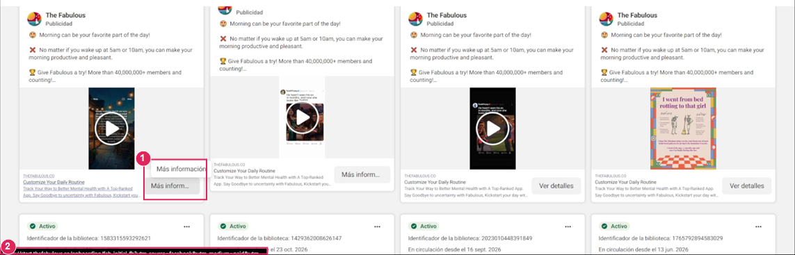

1. CTA del anuncio con el tooltip "Más información". 2. Barra de estado del navegador con la URL de destino (visible sólo con el cursor encima).

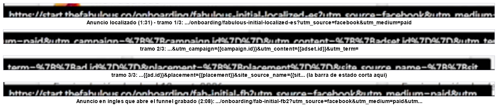

**Qué hacer con esto en Bloom** (decisiones en §9.1-D14):

- Aceptar la entrada `https://start.<dominio>/onboarding/<slug>?utm_source=facebook&utm_medium=paid&utm_campaign={{campaign.id}}&utm_content={{adset.id}}&utm_term={{ad.id}}&placement={{placement}}&site_source_name={{site_source_name}}`. Los `{{…}}` son macros dinámicos de Meta. En la barra de estado la URL se corta tras `…utm_medium=paid&utm_…` y el resto está borroso: **verifícalo antes de usarlo**.
- Slugs observados: `fab-initial-fb2` (inglés; el que se grabó) y `fabulous-initial-localized-es` (español; **no se grabó**). Úsalos como ejemplo de *un slug por variante de funnel e idioma*.
- Persistir `utm_*`, `placement`, `site_source_name`, `fbclid` y el slug en `sessionStorage`, y enviarlos con el lead y los eventos (§6.6).
- La **investigación competitiva** (filtros, detalle del anuncio) es contexto de marketing: **fuera del alcance del producto**.
- Copy del anuncio observado: *"Morning can be your favorite part of the day! · No matter if you wake up at 5am or 10am… · Give Fabulous a try! More than 40,000,000+ members and counting!"*. Es contexto de investigación y **no** forma parte del producto. Observa la **continuidad de mensaje** anuncio → intro (el anuncio habla de mañanas; el intro, de "ver si somos un match").

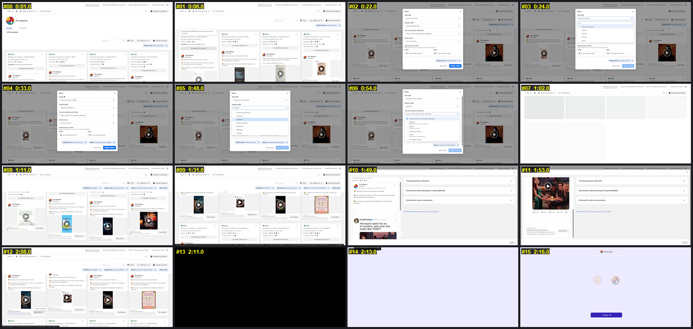

### 3.2 Diferencias dentro del quiz (#01 – #40)

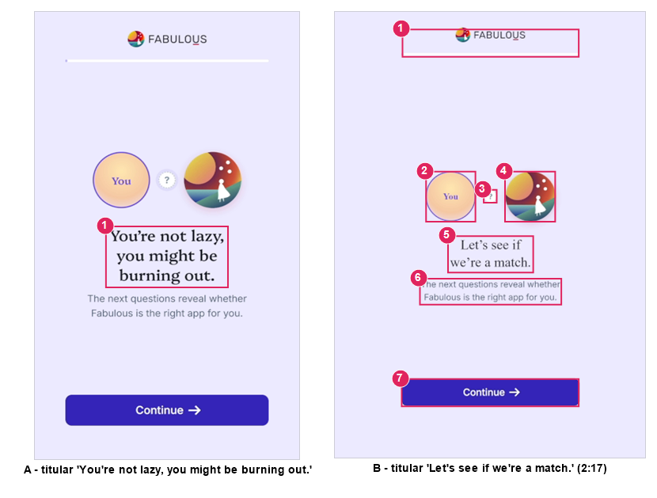

**B:** 1 cabecera (logo + barra de progreso) · 2 burbuja "You" · 3 chip "?" · 4 orbe de marca · 5 titular serif **"Let's see if we're a match."** · 6 subtítulo "The next questions reveal whether {{brand}} is the right app for you." · 7 CTA "Continue →". El resto del intro (reveal, medidas) es igual a `PLAN.md` §5.2. **A** usa "You're not lazy, you might be burning out.".

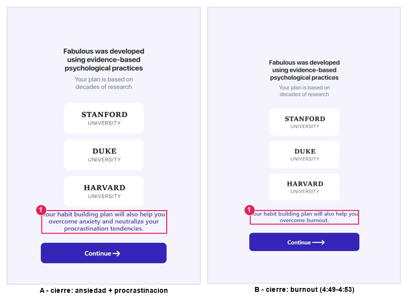

1. La **frase final cambia**: A = "…will also help you overcome anxiety and neutralize your procrastination tendencies." · B = "…will also help you overcome burnout.". Probablemente depende de las burbujas liberadas en el wand (A: Self-doubt, Anxiety, Lack of motivation · B: Self-doubt, Burnout, Anxiety). Regla propuesta en §6.4.

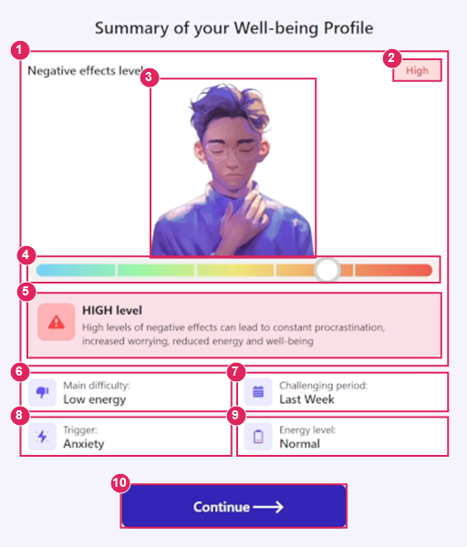

1 tarjeta · 2 pill "High" · 3 ilustración · 4 medidor · 5 alerta "HIGH level" · 6 **Main difficulty: Low energy** · 7 **Challenging period: Last Week** · 8 **Trigger: Anxiety** · 9 **Energy level: Normal** · 10 CTA.

| Dato | Corrida A | Corrida B |
|---|---|---|
| Nivel / perilla | High · ≈ 74 % | High · ≈ 73 % |
| Main difficulty | Manage ADHD | Low energy |
| Challenging period | Few weeks | Last Week |
| Trigger | Anxiety | Anxiety |
| Energy level | Low | Normal |

**Respuestas observadas en la corrida B** (último resaltado antes de avanzar): #02 *Rarely* · #12 *No, I don't think I have ADHD* · #13 *Not really* · #14 *This week* · #15 *Male* (por "Join over 30 million **men**" en #17) · #33 *Stronger habits* · #34 *Going a week without procrastinating* + *Feeling calmer in stressful situations* · wand: *Self-doubt, Burnout, Anxiety*.

> **Hallazgo:** "High" y la perilla (≈ 73–74 %) son **iguales en A y B** pese a respuestas muy distintas. Probablemente son fijos o saturan. No asumas que salen del cuestionario: o los derivas con una regla honesta (§6.4) o los rotulas como ilustrativos. (`src/profile/derive.ts` ya calcula un nivel a partir de las respuestas, `I-32`: conserva ese cálculo.)

### 3.3 Inventario de claims, credenciales y testimonios (se renderizan: guardrails 2 y 3)

Texto **literal** de la referencia con `Fabulous` → `{{brand}}`. Es el contenido que debe vivir en `src/funnel/claims.ts` (registro) y en `copy.en.json`. Los puntos de aparición están en la imagen indicada: `b-16 (2·3)` = panel 2, marca 3; `b-19 (8)` = marca 8.

| Id | Dónde | Texto / elementos | Imagen |
|---|---|---|---|
| **C1 · users** | #17 | Titular `Join over 30 million {{audience}}` + cuerpo `Who transformed their lives using science-backed behaviour change techniques.` | b-16 (1·4, 1·5) |
| | #26 | `{{brand}} has guided more than 30 million {{audience}} towards a happier healthier life using simple behavioral science techniques.` | b-16 (2·3) |
| **C2 · press** | #17 | `As featured on:` + wordmarks en dos filas: **The New York Times · WIRED · Forbes** / **girlboss · healthline** (negro, tipografías distintas por marca) | b-16 (1·3) |
| | Hoja | `As featured in` + **The New York Times · girlboss · Forbes** / **healthline · SELF** en una sola tinta naranja (≈ `#E4A45C` sobre `#FEF5EC`) | b-19 (8) |
| **C3 · universities** | #30 | Título `{{brand}} was developed using evidence-based psychological practices`, subtítulo `Your plan is based on decades of research`, tres tarjetas blancas: **STANFORD / UNIVERSITY**, **DUKE / UNIVERSITY**, **HARVARD / UNIVERSITY** (wordmark serif en mayúsculas + "UNIVERSITY" en gris) | b-16 (3·1–3) |
| **C4 · expert** | #31 | `Your plan will be reviewed by an expert` ("an expert" en violeta), cita `"{{brand}} carefully uses a proven approach to provide personalized guidance and resources that support emotional resilience."`, tarjeta: cabecera `Content reviewed by an expert`, badge verificado verde, **Jazmin Quill, MSc**, `Co-founder, Stanford Psych One Program` | b-16 (4·2–4) |
| | Hoja | Banner naranja `Content reviewed by an expert`; **Jazmin Quill, MA, MSc**; `Co-founder, Stanford Psychology One Program`; cita `"Imagine having someone in your corner, someone who truly believes in you. I've seen our coaches dismantle unseen barriers and unlock innate powers long waiting to emerge."`; **foto circular → avatar genérico** (la foto no se incluye) | b-19 (4–6) |
| **C5 · awards** | Hoja | Título `{{brand}} awards` y tres premios con ícono naranja: **Best App Finalist** — Google Play Awards · **Best Self-Care App 2018** — App Store · **Design Award Winner** — Google Material | b-19 (7) |
| **C6 · testimonials (loader)** | #37 | ★★★★★ **This app is truly amazing! - Alice L.** — *I love it because it keeps me very motivated and focused on the goals I've set for myself to achieve. It makes me accountable and forces me to be consistent 💙.* | b-17 (4) |
| | | ★★★★★ **This app literally changed my life - Tara M.** — *I had found myself at the deep end. You pulled me out, I am sincerely grateful.* | b-17 (5) |
| | | ★★★★★ **{{brand}} is an absolute amazing tool to have & apply in your life! - Remi L.** — *I've been using {{brand}} for at least 5 years. It just gets better and better. I love this app and whenever I'm lost this is always where I come back to.* | b-17 (6) |
| **C7 · reviews (hoja)** | Hoja | `Members love our plans` · ★★★★★ *"Being diagnosed with ADHD as an adult has been a shock but a blessing. A blessing because now I can get control of my life. I'm 45 and I have felt out of control my entire life. I tried everything but now, thanks to a good doctor and program like this I'm getting my life in order and looking forward to living for real for the first time. Thank you Clarify ADHD!! YOU ROCK!"* — **Sabine Rush** | b-19 (2) |
| | | ★★★★★ *"This app is absolutely life changing! I feel so grateful to have found it and I have no regrets in paying for it. It's like having a life coach that is gentle and kind but incredibly wise. I've surrendered to this process and have started to change on the inside. I feel more peace, gratitude and hope for my future by learning how to break things down into smaller steps and celebrate each small progress. Thank you so much. Highly recommended."* — **Chey Here** | b-19 (3) |
| **C8 · companyCost** | #41 | `It costs us {{companyCost}} to compensate our employees for the trial, but please choose the amount you are comfortable with.` (`companyCost = $16.41`) | b-08 (4) |

Reglas de renderizado: autores en negrita (la reseña, en negrita cursiva); estrellas `#FFA034` en la hoja y negras en el loader; los emojis (💙) se conservan; el "5 years" y "Clarify ADHD" se dejan literales (decisión D13, §2.4). **Sin gating**: no hay flag ni condición para ocultarlos.

### 3.4 Pantallas compartidas que cambian por los guardrails v2

El quiz es el mismo en A y B, pero hoy está implementado ocultando estos bloques. Las imágenes son de **esta** grabación.

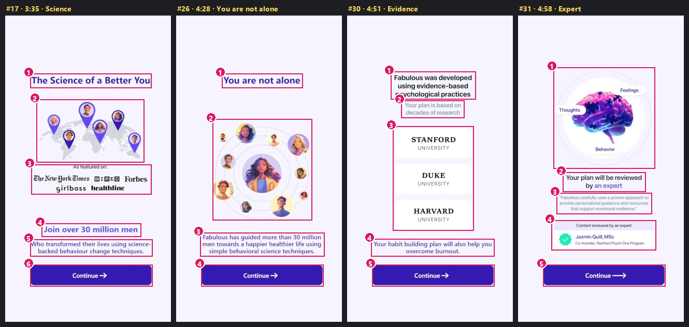

**#17 Science (3:35)** — 1 título `The Science of a Better You` · 2 mapa punteado con 6 pines con avatar · 3 `As featured on:` + wordmarks de prensa (C2) · 4 cifra `Join over 30 million {{audience}}` (violeta `#6C5FFF`, C1) · 5 cuerpo indigo · 6 CTA.
**#26 You are not alone (4:28)** — 1 título · 2 avatar central (≈ 104 px) + 10 satélites en 2 órbitas punteadas · 3 texto indigo de 3 líneas con la cifra (C1) · 4 CTA.
**#30 Evidencia (4:51)** — 1 título de 3 líneas · 2 subtítulo gris · 3 tres tarjetas de universidades (C3) · 4 frase final **según perfil** (§3.2, §6.4) · 5 CTA.
**#31 Revisión experta (4:58)** — 1 anillo punteado con cerebro y chips *Thoughts / Feelings / Behavior* · 2 título con "an expert" en violeta · 3 cita gris · 4 tarjeta del revisor (C4) · 5 CTA.

**Qué cambia respecto del código actual:** `ScienceScreen`, `NotAloneScreen`, `EvidenceScreen` y `ExpertScreen` hoy usan el copy sin claim ("Made for {{audience}} like you", tres tarjetas de prácticas, "Your plan is shaped by how you think, feel and act"). Pasan a mostrar siempre el texto de la tabla C1–C4. Se **conservan** las ilustraciones propias (`src/screens/art/`, `I-26`) y la geometría (`I-28`); se **añaden** los wordmarks de prensa (SVG o texto con familias serif/sans propias, **sin** recortes de `docs/`) y las tarjetas de universidades.

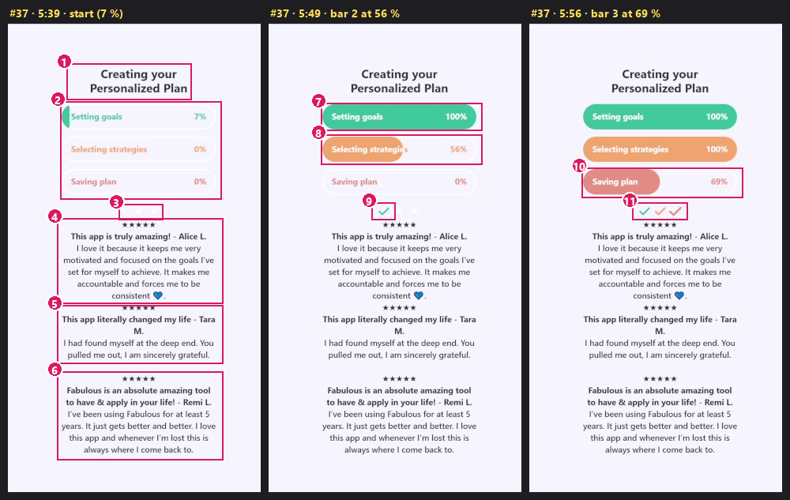

1 título (2 líneas) · 2 tres barras (`--step-1..3`; texto del color del paso sobre la pista y blanco sobre el relleno) · 3 fila de tres puntos (se vuelven checks) · **4, 5, 6 los tres testimonios (C6)**, centrados y apilados, con ★★★★★ negras · 7 barra 1 al 100 % · 8 barra 2 al 56 % (el texto cambia de color en el borde del relleno) · 9 primer check (✓ del color de su barra; los otros dos puntos siguen) · 10 barra 3 al 69 % · 11 tres checks.

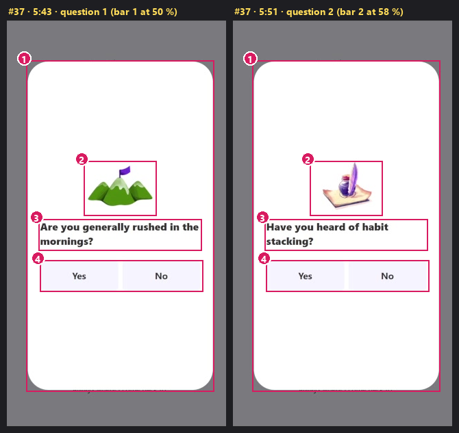

1 modal (≈ 375×648, blanco, radio ≈ 32) sobre backdrop gris · 2 ícono 3D (montaña con bandera / pluma y tintero) · 3 pregunta en negrita, alineada a la izquierda (`Are you generally rushed in the mornings?`, `Have you heard of habit stacking?`) · 4 botones **Yes / No** lado a lado.

**Qué cambia respecto del código actual:** `LoaderScreen.tsx` muestra hoy la sección `tips` (tres notas propias, `I-33`). Reemplázala por los tres testimonios de C6 (estrellas, título con autor en negrita, cuerpo). Barras, checks, modales y guion (`script.ts`) **no cambian**. La página hace scroll si el viewport es bajo, como en la referencia.

---

## 4. Pantallas nuevas del cierre

### 4.1 #41 — Pay what you want

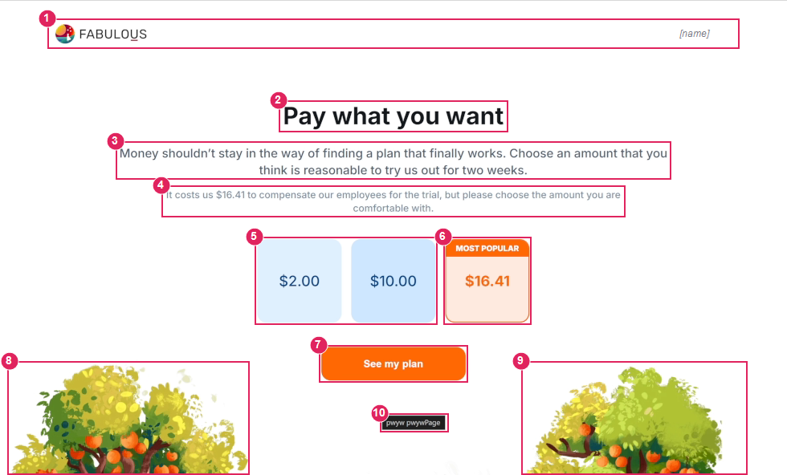

1. Header: logo (izq.) + **chip de usuario** (nombre capturado en #39 + avatar genérico) (der.).
2. Título "Pay what you want" (≈ 30 px de video → **40 px CSS**, peso 700).
3. Párrafo: "Money shouldn't stay in the way of finding a plan that finally works. Choose an amount that you think is reasonable to try us out for two weeks." (≈ 18 px CSS, `#525E69`).
4. Nota: "It costs us $16.41 to compensate our employees for the trial, but please choose the amount you are comfortable with." (≈ 15 px, `#7F8D9C`). **Claim C8 (§3.3): se renderiza.**
5. Tiles **$2.00** (`#DFF0FE`, texto `#193E66`) y **$10.00** (`#CEE7FF`, texto `#123F6E`).
6. Tile **$16.41** con cinta **MOST POPULAR** (cinta `#FF6803` + texto blanco; fondo `#FEEADF`; borde naranja; importe `#FC6A0A`).
7. CTA **"See my plan"** (`#FF6803`, texto blanco, 178×40 px de video → **≈ 242×54 CSS**, radio ≈ 10).
8 y 9. Ilustraciones de árboles de naranjas (izq. y der.), recortadas por el borde inferior → **rehacer como SVG propio** (regla 6).
10. Tooltip oscuro "pwyw pwywPage": **etiqueta de depuración, no replicar**.

| Medida | Video | CSS ≈ |
|---|---|---|
| Tile | 105 × 104 | 143 × 141 (radio ≈ 14) |
| Separación entre tiles | 12 – 14 | 17 – 19 |
| Fila de tiles | 337 de ancho (x 472–809) | 458 |
| Bloque de texto | 690 de ancho | ≈ 940 |

**Comportamiento**

- Pantalla de escritorio, **fondo blanco** y contenido centrado. Los tiles son un grupo de opciones (`radiogroup`); el importe elegido pasa a la hoja como `trialAmount` (en el video la hoja mostró **$2.00**).
- **No se aprecia un estado seleccionado** en el video (el tile de $16.41 lleva el borde naranja de "más popular"). Define un estado explícito (borde 2 px + check). Default propuesto: preseleccionado el más popular (§9.1-D10).
- "See my plan" abre la hoja de §4.2 sobre la página (backdrop gris claro `#E9EAEF`).
- Estados de hover/pressed del CTA y de los tiles: **no observados**.

**Aceptación:** layout y jerarquía de `b-08`, estado seleccionado explícito, el importe viaja a la hoja (y a los 4 sitios de §2.2-4), chip de usuario con el nombre capturado, nota del costo renderizada, sin el tooltip de depuración.

### 4.2 #42 — Hoja de plan: contenedor y carga

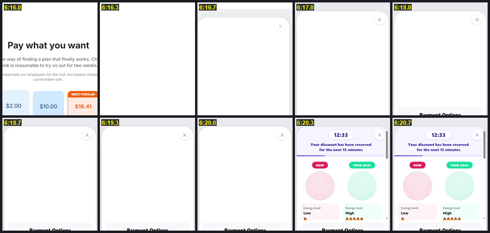

*6:16.0 → 6:20.7.* Secuencia: 1) la página PWYW se vacía a blanco (6:16.3) → 2) aparece la hoja con sombra (6:16.7) → 3) entra el botón **×** (6:17.0) → 4) se pinta primero el bloque inferior *Payment Options* (6:17.7–6:18.7) → 5) se pinta la parte de arriba: cabecera con contador y los avatares como **círculos tintados vacíos** mientras cargan (6:20.3) → 6) a los ≈ 1 s se abre el modal del regalo (6:21.3).

- La hoja es una **columna tipo móvil centrada**: 308 px de video → **≈ 420 px CSS**, radio ≈ 32, margen superior ≈ 42 y fondo de página `#E9EAEF`.
- Lleva una **barra inferior fija** (§4.4, punto 9) y scroll interno.
- Carga progresiva ≈ 4 s en el video; **objetivo en Bloom: < 1.5 s o skeleton claro** (no una hoja en blanco).
- Mobile (< 480 px): supuesto, la hoja ocupa toda la pantalla (no se observó).

### 4.3 Modal del regalo y descuento

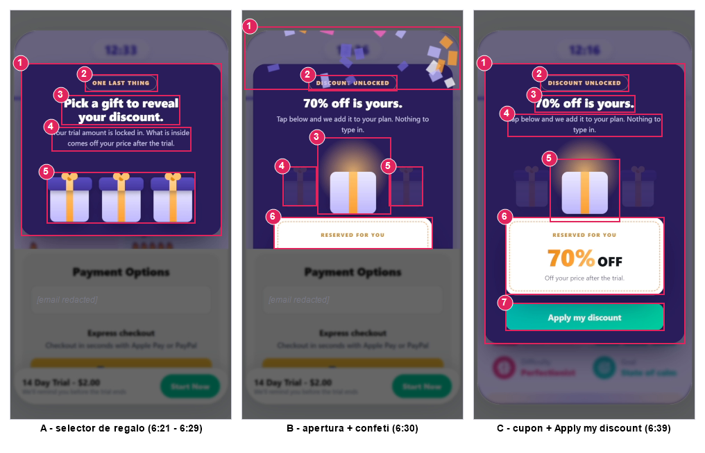

**A — selector (6:21 – 6:29):** 1 modal (`#2A1D5B`) · 2 pill **ONE LAST THING** (borde y texto `#F0BF90`) · 3 título "Pick a gift to reveal your discount." (blanco, peso 800, rounded) · 4 subtítulo "Your trial amount is locked in. What is inside comes off your price after the trial." · 5 **tres regalos** (tapa `#5043B2`, cuerpo `#D3CEFD`, cinta y moño `#E9AC5B`).
**B — apertura (6:30):** 1 confeti en la parte alta · 2 pill **DISCOUNT UNLOCKED** · 3 regalo central abierto con **halo dorado** · 4 y 5 regalos laterales atenuados · 6 cupón blanco "RESERVED FOR YOU".
**C — cupón (6:39):** 1 modal · 2 pill · 3 título **"70% off is yours."** · 4 "Tap below and we add it to your plan. Nothing to type in." · 5 regalo central · 6 cupón: "RESERVED FOR YOU" / **70 % OFF** (`#ED8C13` + "OFF" `#16171A`) / "Off your price after the trial." con **borde punteado dorado** · 7 CTA **"Apply my discount"** (degradado teal `#00B5A9 → #00C49C`, texto blanco).

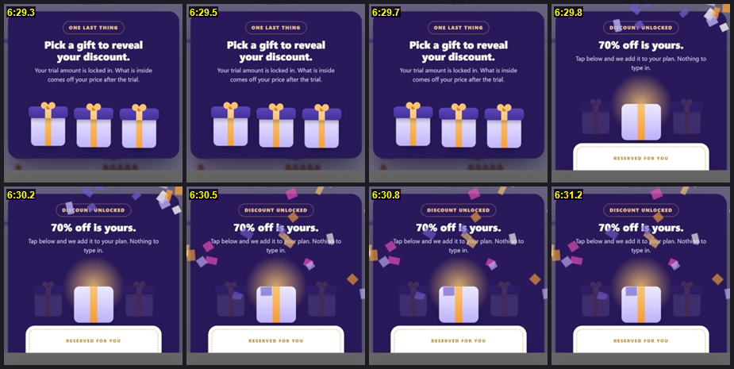

*6:29.3 → 6:31.2.* Los tres regalos **flotan en reposo** (vaivén vertical desfasado, ≈ ±4 px CSS). Al elegir uno (6:29.7 → 6:29.8): los otros dos se atenúan, el elegido pasa al centro con **halo dorado**, el texto cambia a "DISCOUNT UNLOCKED / 70% off is yours." y la tarjeta del cupón sube desde abajo; el **confeti** (cuadrados lavanda, violeta, magenta y naranja) cae desde la parte alta durante ≥ 1.5 s (sigue visible a 6:31.2 y ya no está a 6:39). Al pulsar *Apply my discount* el modal se cierra y la hoja queda con el descuento aplicado (cupón + banner + precio posterior).

- Backdrop: gris oscuro **con desenfoque** de la hoja de fondo.
- **Datos:** `discount = { pct: 70, code: 'off_70_<mes>', grantedAt, expiresAt }`. Se observó **una sola corrida**: se desconoce si los otros regalos dan otro valor (§9.2). **Default de paridad:** tres regalos y todos revelan el mismo descuento (`gift.outcomes = [70, 70, 70]`, configurable); si el product owner prefiere no sugerir azar, `gift.count = 1` (un solo regalo) es una alternativa válida (D11).
- El descuento mostrado **debe aplicarse de verdad** al precio posterior al trial (guardrail 4): el valor del cupón, el banner, la tarjeta del plan y el legal salen de `discount.pct`.
- **A11y:** diálogo con foco atrapado, regalos como botones con nombre accesible ("Regalo 1 de 3"), `prefers-reduced-motion` ⇒ sin vaivén ni confeti.

**Aceptación:** apertura automática ≈ 1 s tras pintar la hoja, selector → apertura → cupón → aplicar, el descuento aparece en la hoja (§4.5) y el modal no reaparece al recargar si ya se aplicó.

### 4.4 Hoja: cabecera y comparación NOW vs YOUR GOAL

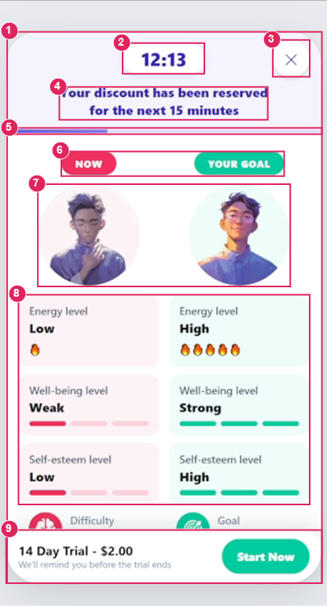

1. Hoja (fondo `#FFFFFF`; cabecera `#F5F4FD`).
2. **Chip del contador** (fondo blanco, texto `#332E5D`, 80×30 px de video → ≈ 109×41 CSS). Arrancó en **12:33** en 6:21 y baja 1 s por segundo. *Sólo con `paywall.countdown.enabled`* (§2.2-5).
3. Botón **×** (círculo blanco 36 px, ícono `#6762A6`).
4. Texto "**Your discount has been reserved for the next 15 minutes**" (`#362C5B`, peso 700, centrado). *Sólo con el flag*; apagado: "Your plan is ready".
5. **Línea fina de progreso** bajo la cabecera (relleno `#685EC9`, pista `#E3E0FC`; ≈ 27 % observado). Al hacer scroll la cabecera se va, pero **la línea queda pegada arriba**. *Sólo con el flag.*
6. Pills **NOW** (`#F12F5F`) y **YOUR GOAL** (`#00CA9F`), texto blanco en mayúsculas.
7. Dos **avatares ilustrados** (círculos de ≈ 100 px de video; fondos `#FDF6F8` y `#EFFDFA`); en el video son figuras masculinas → rehacer como ilustración propia.
8. Seis **tiles** (2 columnas × 3 filas): *Energy level* **Low** (1 llama `#F5A900`) → **High** (5 llamas) · *Well-being level* **Weak** → **Strong** (barra de 3 segmentos, 1 → 3) · *Self-esteem level* **Low** → **High** (1 → 3). Fondos `#FDF3F6` (NOW) y `#EFFDFA` (GOAL); etiqueta `#656268`, valor en negrita `#121820`; barras `#F12F5F` / `#00CA9F` sobre su tinte claro.
9. **Barra inferior fija** (blanco, radio grande): **"14 Day Trial - $2.00"** (peso 700, `#0A0A0A`) + "We'll remind you before the trial ends" (`#A4A8AC`; **no cumple 4.5:1**: oscurécelo) y botón pill **"Start Now"** (`#00CA9F`, texto blanco).

- Debajo de los tiles hay una fila **Difficulty: Perfectionist** (ícono de cerebro en círculo rojo) y **Goal: State of calm** (ícono de diana en círculo verde) (ver `b-11`, punto 1).
- Reglas para derivar los valores: **no observables**; propuesta en §6.4.
- Un único contador: el mismo valor aparece en la cabecera y en el chip del cupón (§4.5). Si llega a 0 **no se observó qué pasa** (§9.2): default en §6.5.

**Aceptación:** layout de `b-10`, contador en marcha (con el flag), barra fija abajo siempre visible, tiles con los estados NOW/GOAL.

### 4.5 Hoja: cupón, banner y tarjeta del plan

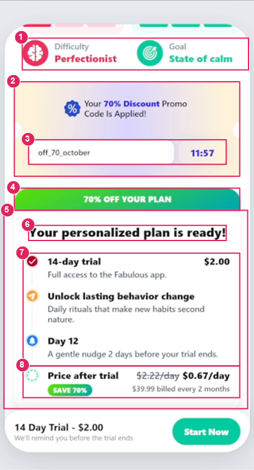

1. Fila **Difficulty / Goal** (íconos 40 px en círculos de color).
2. **Cupón** estilo ticket (degradado `#FEF2DA → #E0DBF6 → #FEF2DA`, muescas laterales): sello con "%" (azul), "Your **70% Discount** Promo Code Is Applied!".
3. Campo blanco con el código **`off_70_october`** + **chip con el mismo contador** (`#F0E7F7`, texto `#423363`; 12:05 en 6:50, 11:57 en 6:58; sólo con el flag). El código incluye el mes (`off_70_<mes>`).
4. **Banner** "70% OFF YOUR PLAN" (degradado lima→teal `#51D912 → #22BD6A → #05ABA1`, texto blanco en mayúsculas).
5. **Tarjeta del plan** (blanco, radio ≈ 16).
6. Título "**Your personalized plan is ready!**" (peso 800, `#0E181F`).
7. **Línea de tiempo** con 3 hitos: ✔ *14-day trial* — **$2.00** — "Full access to the {{brand}} app." · ✈ *Unlock lasting behavior change* — "Daily rituals that make new habits second nature." · 🔔 *Day 12* — "A gentle nudge 2 days before your trial ends." (íconos: `#B1002B`, `#FFA032`, `#167BFB`; hilo vertical gris).
8. Hito final: ◌ *Price after trial* — pill **SAVE 70 %** (degradado lima→teal) · `$2.22/day` **tachado** + **`$0.67/day`** · "$39.99 billed every 2 months".

**Cálculo (verificado):** `perDay = 39.99 / 60 = 0.6665 → $0.67` · `perDayStruck = 0.6665 / (1 − 0.70) = 2.2217 → $2.22` · `fecha del primer cargo = hoy + 14 días` (en el video 31/10 → 14/11/2026; el legal dice "will charge you $39.99 on November 14, 2026"). El descuento se aplica al **precio posterior al trial**; el monto del trial queda fijo. **Guardrail 4:** el tachado y el badge SAVE salen de `listPrice` (precio de lista previo y real); si no existe, no se muestran (§2.2-4).

### 4.6 Hoja: pago

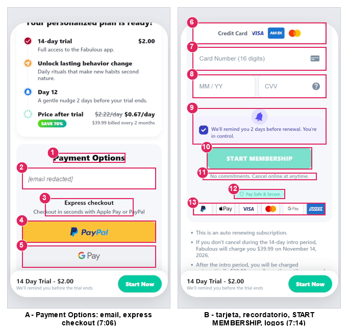

**A (7:06):** 1 título **"Payment Options"** (peso 800, rounded) sobre contenedor `#F6F7FA` · 2 campo de **email precargado** con el de #38 (blanco, radio ≈ 10) · 3 "**Express checkout**" + "Checkout in seconds with Apple Pay or PayPal" · 4 botón **PayPal** (`#FCC237`, radio ≈ 8, alto ≈ 56 CSS) · 5 botón **G Pay** (`#F0F1F4`; Apple Pay sólo en dispositivos compatibles).
**B (7:14):** 6 cabecera **Credit Card · VISA · AMEX · Mastercard** (borde 2 px `#CDD1D5`, radio ≈ 10; es el selector del método tarjeta) · 7 **Card Number (16 digits)** con ícono de tarjeta · 8 **MM / YY** y **CVV (?)** en dos columnas · 9 recuadro `#F4F2FE` con **campana** (círculo `#584FFC`) y casilla **marcada** (`#363DC7`): "We'll remind you 2 days before renewal. You're in control." · 10 botón **START MEMBERSHIP** (**deshabilitado** `#7BE0CC`; habilitado `#00CA9F`) · 11 "No commitments. Cancel online at anytime." · 12 pill **Pay Safe & Secure** (`#BEF7F1`, texto `#56CDAF`) · 13 fila de logos: PayPal, Apple Pay, VISA, Mastercard, G Pay, AMEX.

La imagen `b-18` (§4.9) muestra este bloque completo dentro de la hoja.

**Comportamiento**

- Los botones de **PayPal y Google Pay se montan de forma asíncrona** (los renderiza el proveedor); mientras tanto se ve el contenedor vacío.
- **START MEMBERSHIP** sólo se habilita con tarjeta válida (estado deshabilitado observado). Errores de validación: **no observados**.
- **Guardrail 4:** bajo START MEMBERSHIP, además de "No commitments. Cancel online at anytime.", añade el **resumen del cobro** de §2.2-4 (importe de hoy, importe de renovación, fecha, periodicidad y cómo cancelar). En el video el legal completo queda *debajo*, tras la fila de logos.
- El botón fijo **Start Now** hace *scroll suave* hasta *Payment Options* (observado 8:24–8:28; inferido). Ese bloque debe quedar **a la vista antes** de los textos legales largos.
- Casilla de recordatorio: marcada por defecto; define si la preferencia se guarda (§9.2).
- Clic en **Google Pay** (8:29–8:48): se abre la UI del proveedor con las tarjetas guardadas del usuario y, después, una página de administración de pagos de Google. Es **UI de terceros, fuera de alcance**, y contiene datos personales: **no hay imágenes** (guardrail 7).

**Aceptación:** layout de `b-12`, email precargado, botones asíncronos, tarjeta con campos del proveedor, estado deshabilitado/habilitado de START MEMBERSHIP, resumen del cobro visible, *Start Now* que lleva al pago, **MockCheckoutProvider** por defecto.

### 4.7 Hoja: legal, beneficios y FAQ

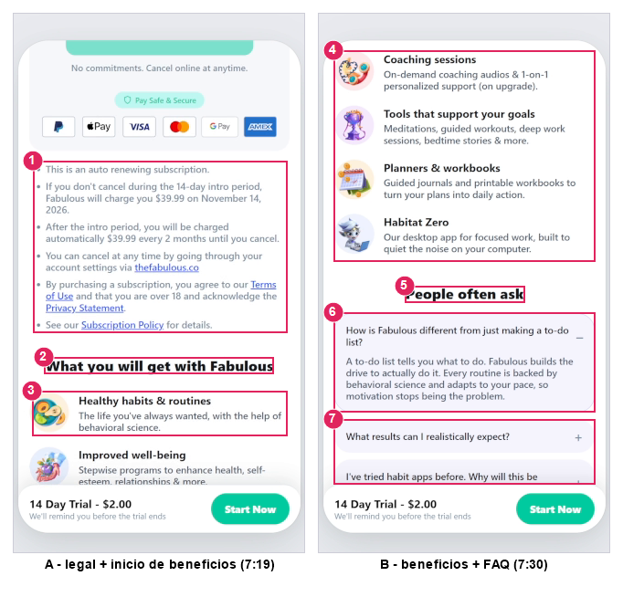

**A (7:19):** 1 **legal** (6 viñetas de ≈ 12 px, `#616065`; enlaces subrayados) · 2 título "What you will get with {{brand}}" · 3 primer beneficio.
**B (7:30):** 4 lista de beneficios · 5 título "People often ask" · 6 primera pregunta **abierta** · 7 resto de preguntas **cerradas**.

**Legal (plantilla; reescribe con los datos reales; guardrail 4):**

- This is an auto renewing subscription.
- If you don't cancel during the 14-day intro period, {{brand}} will charge you {{renewalPrice}} on {{trialEndDate}}.
- After the intro period, you will be charged automatically {{renewalPrice}} every 2 months until you cancel.
- You can cancel at any time by going through your account settings via {{domain}}.
- By purchasing a subscription, you agree to our Terms of Use and that you are over 18 and acknowledge the Privacy Statement.
- See our Subscription Policy for details.

**Beneficios (6)**, cada uno con ilustración 3D en círculo pastel (≈ 40 px de video), título en negrita y descripción gris. Texto de la referencia (JSON): *Healthy habits & routines* · *Improved well-being* · *Coaching sessions* · *Tools that support your goals* · *Planners & workbooks* · *Habitat Zero*. Los íconos se rehacen como arte propio; el texto es editable (`TODO(content)`) porque describe el producto de la referencia (p. ej. *Habitat Zero*).

**FAQ (acordeón de 5, pills `#F5F4FD`, radio ≈ 16, icono + / −):** 1 *How is {{brand}} different from just making a to-do list?* (abierta por defecto; respuesta de 4 líneas: "A to-do list tells you what to do… so motivation stops being the problem.") · 2 *What results can I realistically expect?* · 3 *I've tried habit apps before. Why will this be different?* · 4 *How much time does it actually take?* · 5 *What if I fall off track?*. **Sólo la primera respuesta se ve en el video**; redacta las otras cuatro.

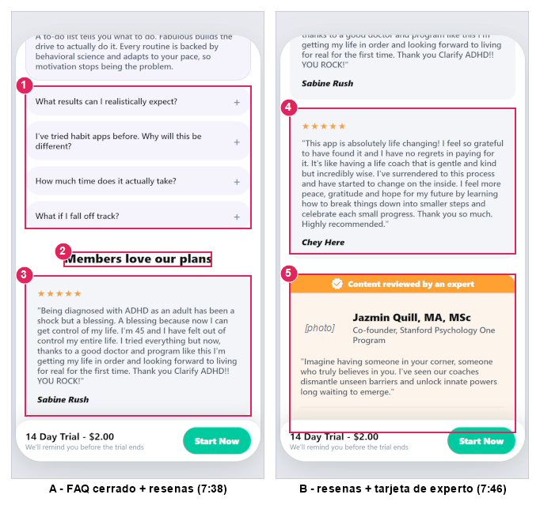

**A (7:38):** 1 preguntas cerradas · 2 título "**Members love our plans**" · 3 reseña 1.
**B (7:46):** 4 reseña 2 · 5 inicio de la tarjeta del experto.

- Cada reseña: tarjeta `#F4F5F8` (radio ≈ 16), **5 estrellas** `#FFA034`, texto `#5E5F62` entre comillas y autor en **negrita cursiva**. **Se renderizan las dos de C7** (§3.3), con el texto exacto.

### 4.8 Hoja: experto, premios, prensa y carta

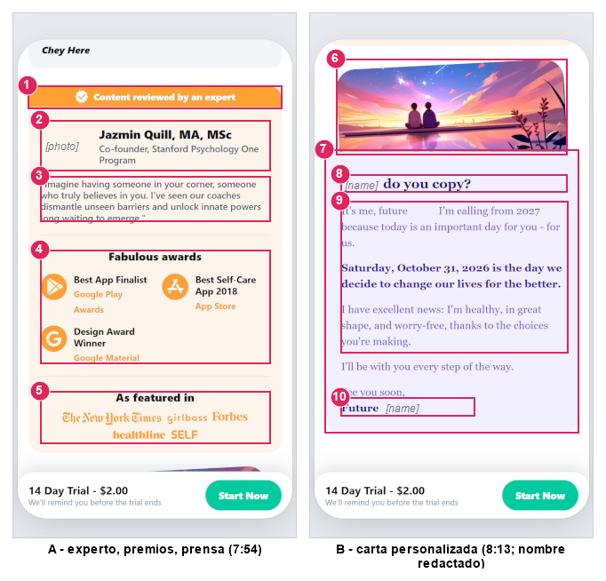

**A (7:54):** 1 cabecera naranja `#FFA032` con sello y "**Content reviewed by an expert**" · 2 identidad del revisor (foto circular, nombre en negrita, cargo) · 3 cita de 3 líneas · 4 "**{{brand}} awards**" (3 premios con ícono naranja `#FFA032` y subtítulo naranja) · 5 "**As featured in**" (logos de prensa en una sola tinta naranja). Cuerpo `#FDF4EB`.
**B (8:13):** 6 ilustración inclinada ≈ −3° que **solapa** la tarjeta · 7 tarjeta de la carta (`#F2F0FE`, radio ≈ 20) · 8 saludo "**{{firstName}}, do you copy?**" (serif, negrita, `#292141`) · 9 cuerpo serif (`#72689B`, frases en negrita para la fecha) · 10 firma "Future {{firstName}}".

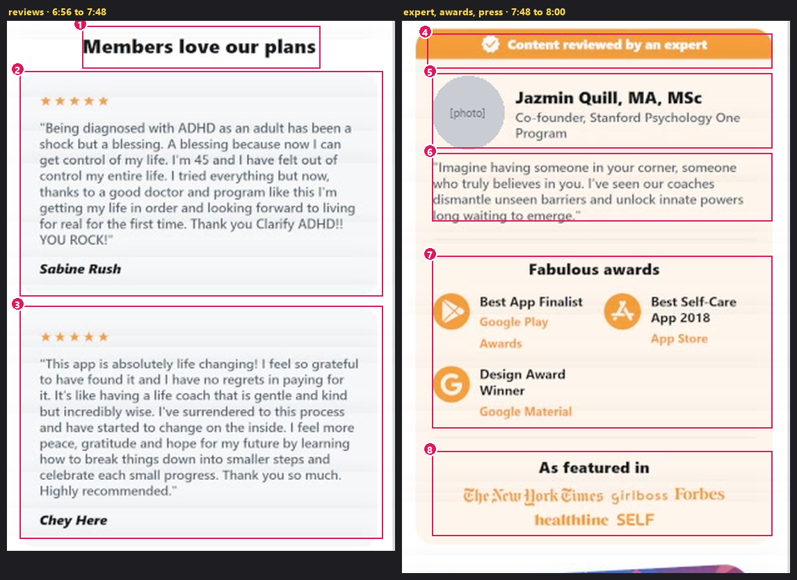

*Ampliación ×1.8 con el texto exacto de C4, C5, C7 y C2.* 1 título `Members love our plans` · 2 reseña 1 (Sabine Rush) · 3 reseña 2 (Chey Here) · 4 banner naranja `Content reviewed by an expert` con sello verificado · 5 revisor (**foto → avatar genérico**, nombre en negrita, cargo) · 6 cita · 7 `{{brand}} awards` (tres premios, ícono naranja, subtítulo naranja) · 8 `As featured in` (wordmarks en una sola tinta).

**Carta (texto de la referencia, con la marca y el nombre como variables):**

- *{{firstName}}, do you copy?* · *It's me, future {{firstName}}. I'm calling from {{año+1}} because today is an important day for you - for us.* · ***{{fecha larga de hoy}} is the day we decide to change our lives for the better.*** · *I have excellent news: I'm healthy, in great shape, and worry-free, thanks to the choices you're making.* · *I'll be with you every step of the way.* · *See you soon, Future {{firstName}}*.
- Paridad: se conserva el texto tal cual. Si el nombre no existe, usa un saludo genérico.

**Aceptación (4.7 y 4.8):** orden de secciones del Apéndice B, acordeón accesible (`aria-expanded`), C2/C4/C5/C7 renderizados con el texto exacto, carta con nombre y fecha dinámicos.

### 4.9 Hoja completa en una captura

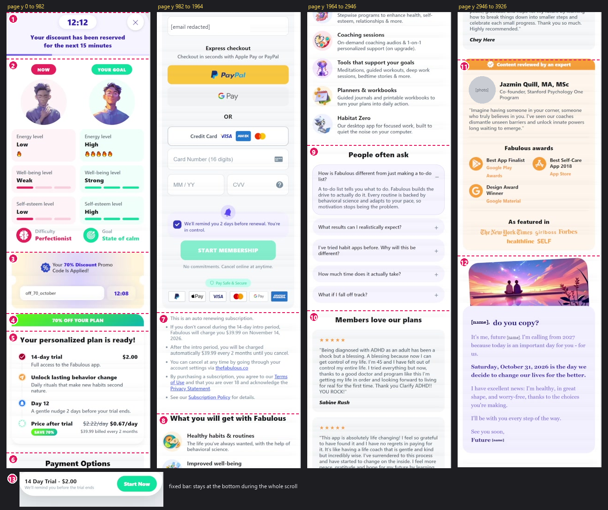

*Captura larga de la hoja (6:43 → 8:20), unida a partir de 150 cuadros; el contenido va en 4 columnas de izquierda a derecha y de arriba abajo.* Los números rojos son las **secciones del Apéndice B, en orden**: 1 cabecera (contador, texto, línea de progreso) · 2 comparación NOW vs YOUR GOAL + Difficulty/Goal · 3 cupón · 4 banner "70% OFF YOUR PLAN" · 5 tarjeta del plan · 6 Payment Options · 7 legal · 8 What you will get · 9 People often ask · 10 Members love our plans · 11 experto + premios + prensa · 12 carta · **13 barra fija** (no scrollea: está sobre el contenido durante todo el recorrido).

- Altura total de la hoja ≈ 3 930 px de video (≈ 5 340 px CSS) con el FAQ en su estado inicial (sólo la primera pregunta abierta).
- El bloque 6 (Payment Options) queda a ≈ 24 % del recorrido, **antes** del legal y de la prueba social.
- Úsala para comprobar el **orden** y los **espacios** entre secciones; las imágenes `b-10…b-15` dan el detalle de cada una.

---

## 5. Sistema visual de la variante B

### 5.1 Tokens de color (muestreados)

| Token propuesto | Valor | Uso |
|---|---|---|
| `--pwyw-bg` / `--pwyw-ink` | `#FFFFFF` / `#111719` | Página *Pay what you want* |
| `--pwyw-p1` / `--pwyw-p2` | `#525E69` / `#7F8D9C` | Párrafo / nota |
| `--pwyw-tile-1` / `-2` | `#DFF0FE` (texto `#193E66`) / `#CEE7FF` (texto `#123F6E`) | Tiles $2 y $10 |
| `--pwyw-tile-3` / `--pwyw-accent` | `#FEEADF` / `#FF6803` (importe `#FC6A0A`) | Tile popular, cinta y CTA |
| `--sheet-page-bg` | `#E9EAEF` | Fondo detrás de la hoja |
| `--sheet-header-bg` / `--sheet-header-ink` | `#F5F4FD` / `#362C5B` | Cabecera de la hoja |
| `--timer-bg` / `--timer-ink` | `#FFFFFF` / `#332E5D` | Chip del contador |
| `--progress-fill` / `--progress-track` | `#685EC9` / `#E3E0FC` | Línea fina de progreso |
| `--close-ink` | `#6762A6` | Botón × |
| `--now` / `--goal` | `#F12F5F` / `#00CA9F` | Pills y barras NOW / YOUR GOAL |
| `--now-tile` / `--goal-tile` | `#FDF3F6` / `#EFFDFA` | Tiles de comparación |
| `--flame` | `#F5A900` | Llamas de *Energy level* |
| `--brand-teal` | `#00CA9F` | **Start Now**, barras GOAL |
| `--sticky-ink` / `--sticky-sub` | `#0A0A0A` / `#A4A8AC` | Barra inferior |
| `--ticket-grad` | `#FEF2DA → #E0DBF6 → #FEF2DA` | Cupón |
| `--ticket-timer-bg` / `-ink` | `#F0E7F7` / `#423363` | Chip del cupón |
| `--green-grad` | `#51D912 → #22BD6A → #05ABA1` | Banner "70% OFF" y pill SAVE |
| `--plan-title-ink` / `--muted-ink` | `#0E181F` / `#616065` | Título del plan / textos secundarios |
| Íconos de la línea de tiempo | `#B1002B` ✔ · `#FFA032` ✈ · `#167BFB` 🔔 · `#86D1BB` ◌ | Hitos |
| `--pay-container` / `--paypal-gold` | `#F6F7FA` / `#FCC237` | Bloque de pago / PayPal |
| `--gpay-bg` | `#F0F1F4` | Botón G Pay |
| `--reminder-bg` / `--reminder-ink` / `--checkbox` | `#F4F2FE` / `#4E4A89` / `#363DC7` | Recordatorio de renovación |
| `--start-disabled` | `#7BE0CC` | START MEMBERSHIP deshabilitado |
| `--safe-pill-bg` / `-ink` | `#BEF7F1` / `#56CDAF` | Pay Safe & Secure |
| `--faq-bg` / `--review-bg` | `#F5F4FD` / `#F4F5F8` | FAQ / reseñas |
| `--star` / `--expert-accent` / `--expert-body` | `#FFA034` / `#FFA032` / `#FDF4EB` | Estrellas y tarjeta del experto (la tinta única de prensa y premios usa `--expert-accent`) |
| `--letter-bg` / `-ink` / `-body` | `#F2F0FE` / `#292141` / `#72689B` | Carta |
| `--gift-modal` / `--gift-pill` | `#2A1D5B` / `#F0BF90` | Modal del regalo |
| `--gift-lid` / `-body` / `-ribbon` | `#5043B2` / `#D3CEFD` / `#E9AC5B` | Cajas de regalo |
| `--coupon-accent` / `--coupon-ink` | `#ED8C13` / `#16171A` | "70%" / "OFF" |
| `--apply-grad` | `#00B5A9 → #00C49C` | *Apply my discount* |
| Confeti | `#C7C1FD`, `#5E53AD`, magenta ≈ `#D9419E` *(estimado)*, naranja ≈ `#F0A33A` *(estimado)* | Apertura |

El quiz de la variante B usa **los mismos tokens que la A** (`PLAN.md` §4.1): fondo `#ECEAFF`, card `#F5F4FD`, CTA `#3424B8`. Los testimonios del loader usan la tinta del texto (`--ink-900`) y estrellas negras; el bloque de prensa de #17, texto negro.

### 5.2 Tipografía (aproximada; no se pudo identificar la fuente)

| Uso | Familia sugerida | Tamaño CSS ≈ | Peso |
|---|---|---|---|
| Títulos *Pay what you want* | Inter | 40 / 48 | 700 |
| Párrafos de PWYW | Inter | 18 / 28 · 15 / 22 | 400 |
| Importes de los tiles | Inter | 24 | 500–600 |
| CTA (PWYW) | Inter | 16 | 600 |
| Títulos de la hoja ("Payment Options", "What you will get…", "People often ask", "Members love our plans") | Sans geométrica **muy negra** y redondeada (p. ej. Baloo 2, Poppins 800 o Lilita One) | 24–28 | 800 |
| Pill y título del regalo | La misma display, mayúsculas con tracking en el pill | 11 · 28 | 700–800 |
| Cuerpo de la hoja | Sans humanista del sistema (en el video, Segoe UI) | 14–16 / 22 | 400–500 |
| Carta | Serif de texto (p. ej. Lora o Source Serif 4) | 16 / 24 | 400–700 |
| Wordmarks de prensa y universidades | Serif de titular en mayúsculas para universidades; una familia distinta por cabecera de prensa (aproximación tipográfica, no logos) | 13–18 | 500–800 |

### 5.3 Layout (video → CSS)

| Elemento | Video | CSS ≈ |
|---|---|---|
| Hoja | 308 de ancho · radio grande | 420 · radio ≈ 32 |
| Contenido de la hoja (padding lateral) | 11 | 15 |
| Chip del contador | 80 × 30 | 109 × 41 |
| Botón × | 36 | 49 |
| Avatares NOW / GOAL | ≈ 100 | 136 |
| Tile de comparación (NOW o GOAL) | 139 × 62 (+ 7 de separación) | 189 × 84 (+ 10) |
| Barra inferior fija | 308 × 52 | 420 × 71 |
| Botón *Start Now* | 94 × 34 | 128 × 46 |
| Modal del regalo | 288 × 243 (selector) · 288 × 404 (cupón) | 392 × 330 · 392 × 549 |
| Botones de pago | 261 × 41 | 355 × 56 |

### 5.4 Movimiento (tiempos observados)

| Elemento | Duración observada |
|---|---|
| Carga de la hoja | ≈ 4 s (objetivo < 1.5 s) |
| Apertura del modal del regalo | ≈ 1 s tras pintar la hoja |
| Reveal del regalo (selección → "DISCOUNT UNLOCKED") | < 0.2 s; confeti ≥ 1.5 s; halo dorado persistente |
| Reposo de los regalos | vaivén lento continuo (≈ ±4 px) |
| Cierre del modal tras *Apply my discount* | inmediato; la hoja se muestra desde arriba |
| *Start Now* → pago | scroll suave ≈ 1 s |
| Contador | 1 s por tick; `mm:ss` |

Respeta `prefers-reduced-motion`.

---

## 6. Arquitectura del cierre B

### 6.1 Flag y modelo de datos

```ts
type ClosingVariant = 'paywall' | 'pwyw';          // funnel.closing (por defecto 'pwyw')

interface PwywStep extends BaseStep {
  type: 'pwyw'; trialDays: 14; companyCost: number;
  tiles: { id: string; amount: number; ribbon?: string }[]; cta: string;
}
interface PlanSheetStep extends BaseStep {
  type: 'plan_sheet';
  countdown: { totalSeconds: 900; startsAt: 'discount_granted' | 'sheet_open'; enabled: boolean };
  sticky: { cta: 'Start Now' };
  sections: SheetSection[];                       // ver funnel.variant-b.reference.json
  gift?: { pills: [string, string]; count: 1 | 3; outcomes: number[] };
}
```

Estado nuevo: `trialAmount`, `discount: { pct, code, grantedAt, expiresAt } | null`, `paymentMethod`, `reminderOptIn` (default `true`). Reutiliza `lead`, `answers`, `profile` y `audience` de `PLAN.md` §6. El flag se lee en build (`NEXT_PUBLIC_FUNNEL_CLOSING`) y, con las dev tools encendidas, por `?closing=` (mismo patrón que `?countdown`, `I-03`/`I-17`).

### 6.2 Máquina de estados

```text
#40 loading ─► #41 pwyw ──(elige importe + "See my plan")──► #42 plan_sheet[loading]
                                                              │ (~1 s tras pintar)
                                                              ▼
                                   gift_modal[picker] ─(elige)─► gift_modal[reveal] ─("Apply my discount")─┐
                                                                                                           ▼
                         plan_sheet[ready, discount aplicado] ─(scroll / "Start Now")─► bloque de pago
                                                                                              │
                                       ┌───────────── PayPal / Google Pay / Apple Pay ────────┤
                                       └──────── tarjeta válida ─► "START MEMBERSHIP" ────────┘
                                                                          ▼
                                                      post-compra: NO observado (§9.2)
```

### 6.3 Precios y fechas

```ts
const perDayRaw       = renewalPrice / periodDays;                  // 39.99 / 60 = 0.6665
const perDay          = round2(perDayRaw);                          // 0.67
const perDayStruck    = listPrice ? round2(listPrice / periodDays) : null;   // sólo con precio previo real
const trialEndDate    = addDays(today, trialDays);                  // 31/10 → 14/11
```

En la referencia el tachado sale de `perDayRaw / (1 − discountPct/100)` = 2.2217 → **$2.22** (con `perDay` ya redondeado daría 2.23: ¡no lo uses!). Eso equivale a un `listPrice` de ≈ $133.30 por 60 días. Bajo el guardrail 4 el tachado se calcula **desde `listPrice`** y sólo existe si ese precio previo es real; el test con los valores de la referencia fija `listPrice = 133.30` como dato demo.

Redondeo *half-up* a centavos **siempre sobre el valor sin redondear**. El texto "Day 12" sale de `trialDays − 2`. Los importes del trial salen de `trialAmount`. Tests unitarios obligatorios (con los valores de este documento).

### 6.4 Reglas propuestas — la referencia **no** las muestra

| Salida | Regla propuesta | Observado |
|---|---|---|
| Frase final de #30 | Por burbuja liberada en el wand: *Burnout* → "overcome burnout" · *Anxiety* → "overcome anxiety" · *Lack of motivation* → "neutralize your procrastination tendencies". Prioridad *Burnout* > *Anxiety* + *Lack of motivation*; sin coincidencia, frase genérica | A → "anxiety … procrastination" · B → "burnout" (2 muestras) |
| Challenging period (#36) | #14: *This week* → "Last Week" · *A few weeks ago* → "Few weeks" · *Months ago* → "Few months" · *I'm not sure I ever have* → "A long time" | "Last Week" (B), "Few weeks" (A) |
| Energy level (#36) | #02: *Always/Often* → "Low" · *Sometimes* → "Normal" · *Rarely* → "Normal" (o "Good") | *Rarely* → "Normal" (B); "Low" (A) |
| Main difficulty (#36) | ADHD sospechado/diagnosticado (#12) → "Manage ADHD"; si no, la dificultad dominante (energía, foco, hábitos). `I-32` ya implementa una variante sin lenguaje diagnóstico: consérvala | "Manage ADHD" (A) · "Low energy" (B, #12 = No) |
| Trigger (#36) | Burbuja liberada de mayor prioridad: Anxiety > Burnout > Self-doubt > Loneliness > Lack of motivation | "Anxiety" en ambas |
| Nivel y perilla (#36) | **No parecen derivarse** (idénticos en A y B). Calcula un puntaje honesto o rotula como ilustrativo | High ≈ 73–74 % en ambas |
| *Goal* de la hoja | #34: *Feeling calmer…* → "State of calm" · *Waking up feeling motivated* → "High energy" · *Going a week without procrastinating* → "Focus" · *Eating healthier meals* → "Healthy habits" · *Sticking to a morning routine* → "Morning routine" | "State of calm" (B; #34 incluía *Feeling calmer*) |
| *Difficulty* de la hoja | Sin evidencia ("Perfectionist" en B). Propuesta: rasgo dominante de #03, #09 y #18–#20 | "Perfectionist" |
| NOW (energía / bienestar / autoestima) | Energía ← #02; autoestima ← *Self-doubt* en el wand; bienestar ← puntaje del perfil. Valores fijos *Low / Weak / Low* si falta dato | Low · Weak · Low (B) |
| GOAL | Siempre High · Strong · High | High · Strong · High |

Marca como *inferido* cada regla hasta que el equipo de contenido la apruebe (D13).

### 6.5 Cuenta regresiva y descuento (guardrail 5)

- Flag: `paywall.countdown.enabled` = el que ya existe (`paywallCountdownEnabled()` en `src/funnel/flags.ts`, `NEXT_PUBLIC_PAYWALL_COUNTDOWN=1`; `?countdown` en dev tools). Una sola fuente para #41 de la variante A y para la hoja de la B.
- Servicio único `CountdownService`: devuelve `remainingMs` calculado contra `expiresAt` (hora de servidor), nunca contra el reloj local. Mientras no haya backend (Fase 8), `expiresAt` se fija al conceder el descuento y se persiste en `sessionStorage` (`I-15`): sigue **sin reiniciarse al recargar**.
- Inicio: **al conceder el descuento** ("Apply my discount"), no antes. En el video el contador ya marcaba **12:33** al abrir la hoja (≈ 2 min 27 s antes, sin un evento visible): **no repliques** un valor de arranque arbitrario.
- Al vencer: se retira el descuento de verdad (precio posterior sin descuento, sin banner, sin SAVE), se oculta el chip y la línea y **no se reinicia**. Es el comportamiento de `I-38` para el paywall de la A.
- Con el flag apagado (default): sin chip, sin línea y el texto es "Your plan is ready"; el descuento aplicado **no vence**.
- Persistir `discount` y `expiresAt` entre recargas.

### 6.6 Atribución, slugs y analytics

- `/onboarding/:slug` (o `/o/:slug`) con un slug por variante e idioma; el slug elige `funnel.closing`, el idioma y el copy.
- Capturar y persistir `utm_*`, `placement`, `site_source_name`, `fbclid` y el slug; adjuntarlos a `lead` y a los eventos. Pixel/CAPI sólo con consentimiento.
- Eventos nuevos: `pwyw_view` · `pwyw_select {amount}` · `sheet_open` · `sheet_ready {ms}` · `gift_view` · `gift_pick {index}` · `discount_apply {pct}` · `countdown_expire` · `start_now_click` · `payment_method_click {method}` · `card_field_focus` · `start_membership_click` · `purchase_success`. Siguen la forma del adaptador de `I-24`.

### 6.7 Integraciones como adaptadores

Reutiliza `LeadService` (`src/services/lead/`) y `CheckoutProvider` (`src/services/checkout/`: `load()`, `pay()`) de `PLAN.md` §6.6 y añade:

- `CheckoutProvider.renderExpress(el, { amount, currency })` y `renderCard(el)` con eventos `onReady / onValid / onSuccess / onError / onCancel`. La interfaz actual recibe `planId`: extiéndela con `trialAmount` sin romper el paywall de la A.
- `PricingService.compute({ trialAmount, discountPct, listPrice?, today })` con las fórmulas de §6.3 (nuevo, junto a `src/pricing/plans.ts`).
- `CountdownService` (§6.5). **Por defecto: `MockCheckoutProvider`**; recomendación para producción: Stripe (Express Checkout Element + Payment Element) o el proveedor que decida el usuario.

### 6.8 Delta con el código actual

Qué cambia en lo ya construido (variante A + quiz) y qué se crea nuevo. Los números `I-xx` son de `DECISIONS.md`.

| Archivo | Hoy | Cambio |
|---|---|---|
| `src/funnel/claims.ts` | `CLAIMS` con `evidence: false`, `hasEvidence`, `claimsProven` (D3, `I-23`) | Pasa a ser el **registro de contenido** de §3.3 (valores, listas de prensa/universidades, revisor, premios, testimonios, reseñas, `companyCost`); sin `evidence`, sin funciones de compuerta |
| `src/funnel/types.ts` | `ClaimRef`; `claimRefs?` en `InterStep` y `LoaderStep` | Borra ambos |
| `src/funnel/steps.ts` | `claimRefs` en #17, #26, #30, #31, #37 | Borra los atributos. Añade los pasos `pwyw` y `plan` (n 41 y 42) del cierre B, seleccionados por `funnel.closing` (prerenderiza ambos cierres; `dynamicParams = false`, `I-14`) |
| `src/funnel/types.ts` (pasos) | `PaywallStep`, `CheckoutStep` | Añade `PwywStep`, `PlanSheetStep` (§6.1) y `StepType 'pwyw' \| 'plan_sheet'` |
| `src/funnel/copy.en.json` | claves `*Claim` (sólo con evidencia) junto a variantes sin claim; `loader.tips` | La variante con claim es la única; borra las claves sin claim y `tips`; añade `loader.testimonials`, `science.press`, `evidence.universities`, `expert.reviewer`, y el copy de `variant-b` (`copy.variant-b.en.json`) |
| `src/funnel/personalize.ts` | `{{claims.*}}` sólo si `evidence` | `templateVars` incluye siempre `claims.users` y el resto de valores |
| `src/screens/inter/{Science,NotAlone,Evidence,Expert}Screen.tsx` | usan `claimsProven(...)` para elegir copy y ocultan prensa, universidades y revisor | Renderizan siempre prensa (#17), cifras (#17, #26), universidades (#30) y tarjeta del revisor (#31); la frase final de #30 depende del perfil (§6.4) |
| `src/screens/loader/LoaderScreen.tsx` | tres notas propias (`tips`) | Tres testimonios (C6) |
| `src/screens/intro/IntroScreen.tsx` | titular de la A | Titular por variante (§3.2) |
| `src/screens/paywall/*` | cierre A | Sin cambios; se sirve con `funnel.closing = 'paywall'` |
| `src/screens/pwyw/*`, `src/screens/plan/*` | — | **Nuevos**: PWYW, hoja (contenedor, secciones, barra fija), modal del regalo, bloque de pago |
| `src/pricing/*`, `src/services/checkout/*` | planes de A, `planId` | `PricingService`, `trialAmount`, extensión del `CheckoutProvider` |
| `tests/unit/screens/interstitials.test.tsx` (`REFERENCE_CLAIMS`) | afirma que **no** aparece ningún claim | Invertir: cada claim de §3.3 aparece en su pantalla |
| `tests/e2e/funnel.spec.ts` (`CLAIMS` en "intro and interstitials") | idem | Invertir |
| `tests/unit/funnel/personalize.test.ts` | `hasEvidence('users') === false` | Reemplazar por: `templateVars` incluye `claims.users` |
| `tests/unit/screens/loader.test.tsx` | notas propias | Testimonios C6 |
| `tests/unit/referenceAssets.test.ts`, `tests/unit/sourcePrivacy.test.ts` | — | **Nuevos** (§8.4) |
| `scripts/shots.spec.ts` | captura los 42 pasos | Añade los pasos #41 y #42 de la B (con la hoja en sus estados) |
| `docs/feature-parity/*` | D3, `I-23`, `I-29`, `I-33`, `claimRef` en los JSON | Marca como reemplazadas; los JSON ya están actualizados |

---

## 7. Plan de ejecución por fases

| Fase | Objetivo | Pasos | Esfuerzo | Depende de |
|---|---|---|---|---|
| B0 | Decisiones, flag `funnel.closing`, config de la B y tests-guardia (imágenes y privacidad) | — | S | PLAN.md 0–2 (hechas) |
| **B1** | **Guardrails v2 en el quiz compartido** (claims, credenciales, testimonios) + deltas B (#01, #30, #36) | #01, #17, #26, #30, #31, #36, #37 | L | B0 |
| B2 | Página *Pay what you want* | #41 | M | B0 |
| B3 | Hoja de plan: contenedor, carga, cabecera, barra fija, contador | #42 | M | B0 |
| B4 | Secciones de la hoja | #42 | L | B3 |
| B5 | Modal del regalo y descuento | #42 | M | B3 |
| B6 | Bloque de pago (mock) y comportamiento de *Start Now* | #42 | M | B3, PLAN.md 7 (hecha) |
| B7 | Atribución, slugs y analytics | entrada | S | B0 |
| B8 | QA, accesibilidad, rendimiento y responsive | todos | M | B1–B7 |

*B1, B2, B3 y B7 pueden ir en paralelo (B1 toca el quiz; B2/B3 el cierre; B7 la entrada). B4, B5 y B6 comparten archivos de la hoja: ejecútalas en serie o repártelas por componente.*

### Fase B0 — Decisiones, flag y guardias
1. Registra en `DECISIONS.md` D9–D15 (§9.1) con el default adoptado y marca D3, `I-23`, `I-29` e `I-33` (testimonios) como reemplazadas por v2.
2. Añade `funnel.closing` (`'pwyw'` por defecto) y el enrutado `/s/pwyw` y `/s/plan` (§6.8).
3. Crea `src/funnel/copy.variant-b.en.json` desde `funnel.variant-b.reference.json` (copy con `{{brand}}`, **sin** `claimRef`).
4. Reutiliza los tokens de §5.1 en `styles/tokens.b.css`.
5. Crea los tests `referenceAssets` y `sourcePrivacy` (§8.4) **antes** de escribir contenido: así cualquier fuga se detecta desde el primer commit.
**Aceptación:** el flag conmuta entre el cierre A y el B (stub) sin romper el quiz; los tests-guardia pasan.

### Fase B1 — Guardrails v2 en el quiz y deltas de la B
1. Convierte `claims.ts` en el registro de §3.3 y borra `ClaimRef`, `claimRefs`, `hasEvidence`, `claimsProven` y `evidence` (§6.8). `git grep -n -i "claimRef\|claimsProven\|hasEvidence"` queda vacío.
2. Actualiza `copy.en.json` y las pantallas #17, #26, #30, #31 (§3.4): prensa, cifras, universidades, tarjeta del revisor. Wordmarks y arte propios (nada de `docs/`).
3. Reemplaza `tips` del loader por los tres testimonios (C6).
4. Titular del intro por variante (§3.2); frase final de #30 por reglas de §6.4; valores del resumen (#36) por reglas de §6.4 (conserva `I-32`).
5. Invierte los tests de §6.8 y añade los de cada claim. Registra las decisiones `I-43…` en `DECISIONS.md`.
**Aceptación:** `b-16`, `b-17`, `b-17b`, `b-05`, `b-06`, `b-07`; los claims de §3.3 aparecen en #17, #26, #30, #31 y #37 y **no** hay gating; tests de las reglas con las respuestas observadas (§3.2).

### Fase B2 — Pay what you want
Implementa §4.1: header con chip de usuario, tres tiles (`radiogroup`, estado explícito), CTA, ilustraciones propias, `trialAmount`, nota del costo (C8).
**Aceptación:** `b-08`; el importe viaja a la hoja; sin el tooltip de depuración.

### Fase B3 — Hoja de plan: contenedor
Implementa §4.2 y §4.4 (puntos 1–5 y 9): modal, carga progresiva con skeleton, cabecera, contador (tras el flag), línea de progreso, barra fija.
**Aceptación:** `b-anim-02`, `b-10` (parte superior); el contador es del servidor/persistido y no se reinicia.

### Fase B4 — Secciones de la hoja
Implementa en orden (Apéndice B, `b-18`): comparación NOW/GOAL (§4.4) → cupón y banner (§4.5) → tarjeta del plan con cálculos (§4.5, §6.3) → legal, beneficios, FAQ, reseñas (§4.7) → experto, premios, prensa y carta (§4.8). Contenido de C2, C4, C5 y C7 renderizado; assets propios.
**Aceptación:** `b-10` … `b-15`, `b-18`, `b-19`; el precio y la fecha legal siempre coinciden con `trialAmount` y `discount`.

### Fase B5 — Modal del regalo
Implementa §4.3: apertura ≈ 1 s tras pintar, vaivén, selección, halo, confeti, cupón, *Apply my discount*, persistencia del descuento.
**Aceptación:** `b-09`, `b-anim-01`; `prefers-reduced-motion` sin vaivén ni confeti; el descuento aplicado cambia el precio posterior al trial.

### Fase B6 — Pago (mock) y *Start Now*
Implementa §4.6 con `MockCheckoutProvider`: botones asíncronos, tarjeta, recordatorio, estado de START MEMBERSHIP, resumen del cobro (guardrail 4), *scroll* desde *Start Now*.
**Aceptación:** `b-12`; el email llega precargado; START MEMBERSHIP deshabilitado hasta tener tarjeta válida.

### Fase B7 — Atribución y analytics
Implementa §6.6: captura de UTM/slug, persistencia, eventos y consentimiento.
**Aceptación:** test e2e con una URL con UTM; los parámetros llegan a `LeadService` y a los eventos.

### Fase B8 — QA
Ejecuta §8 completo; viewports móviles (360–430 px) y escritorio; LCP/CLS; contraste y foco.

---

## 8. Verificación de paridad

### 8.1 Checklist por pantalla (marcar con evidencia)

- [ ] **Entrada**: UTM + slug persistidos y enviados con el lead (§3.1, §6.6)
- [ ] **Intro B**: titular "Let's see if we're a match." (`b-05`)
- [ ] **#17 / #26 / #30 / #31**: prensa, cifras, universidades, revisor, tal como `b-16` (C1–C4)
- [ ] **#30**: frase final según perfil (`b-06`)
- [ ] **#36**: valores según §6.4, medidor honesto/rotulado (`b-07`)
- [ ] **#37**: tres testimonios (C6), barras, checks y 2 modales (`b-17`, `b-17b`)
- [ ] **#41 PWYW**: layout, 3 tiles con estado seleccionado, CTA, importe → hoja, nota del costo (`b-08`)
- [ ] **Hoja — carga**: skeleton, ×, avatares tintados, < 1.5 s (`b-anim-02`)
- [ ] **Regalo**: apertura, selección, halo, confeti, cupón, aplicar (`b-09`, `b-anim-01`)
- [ ] **Cabecera y comparación**: contador (con flag), línea fina fija, NOW vs GOAL, barra inferior (`b-10`)
- [ ] **Cupón + plan**: código con mes, contador, banner, línea de tiempo, cálculos, tachado sólo con `listPrice` (`b-11`)
- [ ] **Pago**: email precargado, express asíncrono, tarjeta, recordatorio, START MEMBERSHIP, resumen del cobro (`b-12`)
- [ ] **Legal / beneficios / FAQ / reseñas**: plantillas dinámicas, acordeón, C7 con el texto exacto (`b-13`, `b-14`, `b-19`)
- [ ] **Experto, premios, prensa y carta**: C2, C4, C5 renderizados; carta dinámica (`b-15`, `b-19`)
- [ ] **Hoja completa**: orden de secciones del Apéndice B (`b-18`)
- [ ] **Guardrails**: los 7 de §2.1, con sus tests (§2.2, §8.4)

### 8.2 Procedimiento de comparación visual

1. `npm run shots` captura cada pantalla con Playwright a **1280×720** en `docs/feature-parity/shots/` (ignorado por git).
2. Compara con la imagen de referencia: layout, jerarquía, medidas **relativas** (§5.3) y colores (§5.1). Las referencias traen anotaciones y fueron grabadas a ≈ 73 % de zoom: compara por **proporciones**, no por píxel exacto.
3. Para animaciones, captura frames en los tiempos de `b-anim-*.png`.
4. Registra las diferencias aceptadas en `DECISIONS.md`.

### 8.3 Accesibilidad, responsive y rendimiento

- Teclado completo; `role="dialog"` con foco atrapado (hoja y regalo); `aria-live` para el contador sin leer cada segundo (anuncia cada minuto); `radiogroup` en los tiles; acordeón con `aria-expanded`; contraste ≥ 4.5:1 (revisa `#A4A8AC` sobre blanco y el texto naranja de premios/prensa sobre `#FDF4EB`: **no cumplen**; oscurécelos conservando el matiz).
- `prefers-reduced-motion` en regalo, confeti, vaivén y scroll suave.
- Mobile < 480 px: hoja a pantalla completa, barra fija respetando el *safe area*, targets ≥ 44 px, sin scroll horizontal.
- LCP < 2.5 s, CLS < 0.1; imágenes optimizadas; carga diferida del proveedor de pago.

### 8.4 Pruebas automatizadas

- **Unit:** `PricingService` (valores de §6.3), reglas de §6.4, `CountdownService` (vencimiento y persistencia), UTM, `claims` (cada id de §3.3 existe y no está vacío).
- **Componentes:** tiles PWYW, regalo, acordeón, formulario de tarjeta (mock), testimonios del loader.
- **E2E (Playwright):** recorrido completo hasta START MEMBERSHIP con `MockCheckoutProvider`; elegir $2.00 / $10.00 / $16.41 ⇒ el mismo importe en #41, barra fija, bloque de pago, legal y total; reanudación y **no reinicio del contador tras recarga** (con el flag); cada claim de §3.3 visible en su pantalla.
- **Guardia `referenceAssets` (guardrail 6):** (a) ningún archivo de `src/`, `public/` (si existiera) o `tests/` tiene el mismo hash que uno de `docs/feature-parity/images/`; (b) ninguna cadena `feature-parity/images` en `src/`; (c) tras `next build`, `.next/` no contiene `feature-parity`.
- **Guardia `sourcePrivacy` (guardrail 7):** escanea `src/`, `tests/` y `scripts/`: sin emails cuyo dominio no sea reservado (`example.*`, `*.test`, `*.invalid`, `*.localhost`), con una allowlist explícita para los literales sintéticos que ya usan los tests (`a@b.co`, `b@c.co`, `x@sub.domain.io` en `tests/unit/services/lead.test.ts` y `tests/unit/funnel/state.test.ts`), y sin secuencias de 13–19 dígitos con forma de tarjeta. No contiene los valores del video: los detecta por patrón.

---

## 9. Supuestos, ambigüedades y preguntas

### 9.1 Bloqueantes para el usuario (con default si no responde)

| ID | Pregunta | Default (v2) |
|---|---|---|
| D9 | ¿Qué cierre es el principal: *Pay what you want* (B) o el paywall de 3 planes (A)? | Ambos tras `funnel.closing`; empezar por `pwyw` (más completo en el video) |
| D10 | ¿Se mantiene el modelo *Pay what you want*? Importes, trial de 14 días y costo | Importes configurables ($2 / $10 / $16.41 de demo); **con** la nota del costo (C8); preseleccionado el más popular |
| D11 | Mecánica del regalo, cupón y contador: ¿el descuento es real y vence? | Tres regalos con el mismo resultado (`outcomes = [70,70,70]`), `count = 1` como alternativa; descuento real aplicado al precio; contador apagado salvo vencimiento real |
| D12 | Precios, moneda y periodicidad (trial 14 días, renovación cada 2 meses, descuento 70 %) | Valores de demo vía `MockCheckoutProvider`, etiquetados "Demo prices"; tachado sólo con `listPrice` real |
| D13 | Prueba social (cifras, prensa, universidades, revisor, premios, testimonios, reseñas, carta) y reglas de §6.4 | **Renderizar todo** (guardrails 2 y 3), contenido en `claims.ts`; reglas de perfil marcadas "inferido". Riesgos en §2.4 |
| D14 | Atribución: ¿UTM, slugs por idioma, píxel y consentimiento? ¿Hace falta el funnel en español (`fabulous-initial-localized-es`)? | Capturar UTM; slug por idioma; ES después; sin píxel hasta tener consentimiento |
| D15 | ¿La investigación en la Biblioteca de anuncios es parte del alcance? | No (contexto de marketing) |

### 9.2 Lo que el video no permite saber

1. Qué pasa al cerrar la hoja (×) y al llegar el contador a 0.
2. Cómo se marca el tile elegido en PWYW y si los otros importes ($10, $16.41) cambian la hoja o el modal del regalo.
3. Si los otros dos regalos dan otro valor; si el elegido determina algo.
4. Cuándo y por qué arrancó el contador (≈ 2 min 27 s antes de abrir la hoja).
5. Validaciones y errores del formulario de tarjeta; qué hace START MEMBERSHIP al enviarse; el estado post-compra (éxito, cuenta, descarga de la app, upsells).
6. Cómo se derivan NOW vs GOAL, Difficulty/Goal y los avatares (¿por género?).
7. Las respuestas de 4 de las 5 preguntas del FAQ.
8. Diseño móvil/responsive de la hoja y de PWYW (todo se grabó en escritorio con zoom reducido).
9. Tipografías exactas.
10. La URL completa tras `utm_medium=paid&utm_…` (la barra de estado la corta) y los parámetros reales.
11. Si el "Start Now" fijo hace *scroll* o abre el pago (se infirió por 8:24–8:28).
12. Qué es el tooltip "pwyw pwywPage" (probable etiqueta de depuración).
13. Si el "Challenging period", "Energy level" y las frases dependen de otras respuestas (sólo hay 2 corridas).
14. Si los testimonios y las reseñas rotan o cambian entre visitas (se vio una sola vez cada uno).

### 9.3 Comportamientos del original que **no** se replican

- Tooltip de depuración "pwyw pwywPage".
- Pantalla en blanco de ≈ 4–5 s antes de PWYW (#40) y hoja en blanco de ≈ 4 s al abrirse.
- Contador que arranca en un valor arbitrario (12:33) y cuya semántica de reinicio es desconocida.
- Legal por debajo del botón de pago **sin** resumen del cargo cerca del botón (guardrail 4).
- Línea de progreso bajo la cabecera con semántica desconocida (≈ 27 %): sólo existe con el flag del contador.
- Precio tachado derivado del porcentaje de descuento (guardrail 4).

---

## Apéndice A — Índice de imágenes

| Archivo | Momento | Contenido |
|---|---|---|
| `b-00a-overview-quiz.png` | 2:17 – 6:08 | Mosaico del quiz (43 estados) |
| `b-00b-overview-closing.png` | 6:13 – 8:24 | Mosaico del cierre (20 estados) |
| `b-00c-overview-adlibrary.png` | 0:01 – 2:16 | Mosaico de la Biblioteca de anuncios y la carga del funnel |
| `b-01-adlibrary-results.png` | 1:40 | Resultados filtrados (anotada) |
| `b-02-adlibrary-filters.png` | 0:24 – 0:54 | Filtros: Idioma, Plataforma, Tipo de contenido |
| `b-03-adlibrary-ad-detail.png` | 1:49 | Detalle del anuncio |
| `b-04a-ad-cta-hover.png` | 2:08 | CTA del anuncio con hover |
| `b-04b-ad-destination-urls.png` | 1:31 / 2:08 | URL de destino leída de la barra de estado |
| `b-05-intro-variants.png` | 2:17 | Intro: A vs B |
| `b-06-evidence-variants.png` | 4:53 | Paso #30: A vs B |
| `b-07-summary-b.png` | 5:37 | Resumen del perfil B |
| **`b-16-claims-quiz.png`** | 3:35 / 4:28 / 4:51 / 4:58 | **Nueva (v2).** #17, #26, #30 y #31 con sus claims y credenciales, anotadas |
| **`b-17-loader-testimonials.png`** | 5:39 / 5:49 / 5:56 | **Nueva (v2).** Loader en 3 estados con los tres testimonios |
| **`b-17b-loader-questions.png`** | 5:43 / 5:51 | **Nueva (v2).** Las dos preguntas que interrumpen el loader |
| `b-08-pwyw.png` | 6:13 | Pay what you want |
| `b-09-gift-reveal.png` | 6:24 / 6:30 / 6:39 | Selector, apertura y cupón |
| `b-10-sheet-top.png` | 6:42 | Cabecera, contador y NOW vs GOAL |
| `b-11-sheet-plan.png` | 6:58 | Cupón, banner y tarjeta del plan |
| `b-12-sheet-payment.png` | 7:06 / 7:14 | Pago |
| `b-13-sheet-legal-benefits.png` | 7:19 / 7:30 | Legal, beneficios y FAQ |
| `b-14-sheet-faq-reviews.png` | 7:38 / 7:46 | FAQ y reseñas |
| `b-15-sheet-expert-letter.png` | 7:54 / 8:13 | Experto, premios, prensa y carta |
| **`b-18-sheet-fullpage.png`** | 6:43 – 8:20 | **Nueva (v2).** La hoja completa en una captura, con las 13 secciones numeradas |
| **`b-19-sheet-social-proof.png`** | 7:00 – 8:00 | **Nueva (v2).** Reseñas, revisor, premios y prensa ampliados ×1.8 |
| `b-anim-01-gift-reveal.png` | 6:29 – 6:31 | Secuencia de apertura del regalo |
| `b-anim-02-sheet-loading.png` | 6:16 – 6:21 | Secuencia de carga de la hoja |

*Todas las imágenes con datos del video los llevan redactados (`[email redacted]`, `[name]`, `[photo]`).*

## Apéndice B — Orden de las secciones de la hoja

1. Cabecera (contador + texto + línea de progreso) · 2. Comparación NOW vs YOUR GOAL (+ Difficulty / Goal) · 3. Cupón (visible tras aplicar el regalo) · 4. Banner "70% OFF YOUR PLAN" · 5. Tarjeta del plan · 6. **Payment Options** (email, express, tarjeta, recordatorio, START MEMBERSHIP, logos) · 7. Legal · 8. What you will get · 9. People often ask · 10. Members love our plans · 11. Content reviewed by an expert (+ awards + featured in) · 12. Carta de "future you" · 13. Barra inferior fija **durante toda la hoja**. Imagen: `b-18`.

## Apéndice C — Cómo se hizo este análisis

**Versión original.** El video se recorrió completo con 533 cuadros (1 por segundo) reducidos a 129 estados distintos para revisarlos en mosaicos, más secuencias de hasta 10 cuadros por segundo en las partes animadas (regalo, carga de la hoja, wand) y más de 80 cuadros exactos a resolución completa para medir color y geometría por muestreo de píxeles. Las medidas se confirmaron contra mediciones en la grabación A. El audio se analizó por separado: es silencio digital. No se hizo inspección de red ni del DOM: los selectores, fuentes y comportamientos no visibles se señalan como inferidos o desconocidos.

**Revisión v2 (2026-11-02).** Se recorrió de nuevo el video completo: 533 cuadros a 1 fps; mosaicos cada 4 s sobre todo el recorrido; cuadros a **resolución nativa** en cada pantalla con claims (#01, #17, #26, #27, #30, #31, #36, #37 y sus modales); 4 fps en la carga de la hoja y la apertura del regalo (6:12–6:46) y durante el scroll de la hoja (6:40–8:52). La hoja se recompuso en **una captura larga** alineando 150 cuadros consecutivos por desplazamiento vertical, lo que permitió transcribir sin saltos las reseñas, el revisor, los premios, la prensa, los beneficios, el FAQ, el legal y la carta. Los textos de §3.3 se leyeron de cuadros nativos o ampliados ×1.8. Los títulos y opciones del quiz se contrastaron con `funnel.reference.json`. Los datos personales (email escrito, nombre, foto del revisor) se taparon antes de guardar cualquier imagen.

Para extraer un cuadro exacto: `ffmpeg -ss <m:ss> -i fabulousFunnel.mkv -frames:v 1 -vf "crop=1270:593:5:64" frame.png` (recorta el letterbox; el viewport del navegador queda a ≈ 73 % de zoom, §1.2).
