# Feature Parity Plan — Funnel de onboarding de Bloom

| | |
|---|---|
| **Referencia** | Funnel web de onboarding de *Fabulous*, grabado en `2026-10-29 01-53-06.mkv` (6:33) |
| **A construir** | **Bloom** — este repo (hoy vacío) |
| **Alcance** | Del primer paso del funnel hasta el modal de checkout (42 pasos) |
| **Datos máquina-legibles** | [`funnel.reference.json`](funnel.reference.json) · tracker: [`PARITY_STATUS.md`](PARITY_STATUS.md) |
| **Imágenes** | [`images/`](images/) (26 PNG, 3.6 MB) |
| **Fecha / autor** | 2026-10-29 · análisis visual cuadro a cuadro del video |

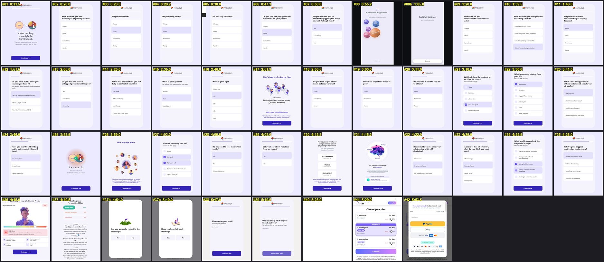

*Cada mosaico lleva `#NN` (número de paso, §3) y el minuto aproximado del video. Los pasos 08b, 37b y 37c son estados extra de la pantalla interactiva y de las dos preguntas que interrumpen el loader.*

---

## 0. Léeme primero (para el agente ejecutor)

**Objetivo.** Construir en este repo un funnel web de onboarding con **paridad funcional y visual** con el de referencia: 28 preguntas, 6 pantallas intermedias/interactivas, resumen de perfil, loader "creando tu plan", captura de email y nombre, paywall y checkout.

**Paridad significa:** mismas pantallas, mismo orden, mismas mecánicas, mismo layout, estados y tiempos de animación. **No significa copiar** marca, ilustraciones, logos de terceros, testimonios, credenciales ni cifras de la referencia (ver §2).

**Cómo trabajar**

1. Lee §1 (cómo interpretar las imágenes), §2 (guardrails) y §3 (mapa de pasos).
2. Ejecuta las fases de §7 en orden. Las fases 3, 4, 5 y 6 son independientes entre sí y pueden repartirse entre agentes en paralelo (carpetas distintas, sin tocar los mismos archivos).
3. Cada pantalla tiene su sección en §5: imagen anotada (números rojos ↔ leyenda), medidas, estados, comportamiento y criterios de aceptación.
4. El copy, las opciones y los precios de referencia están en `funnel.reference.json`. Úsalo para sembrar la configuración del funnel.
5. Lo que no se ve en el video se resuelve con el default de §9 y se registra en `docs/feature-parity/DECISIONS.md` (créalo tú). Sólo pregunta al usuario por los **bloqueantes** de §9.1.
6. No cierres una fase sin evidencia: lint + tests + build en verde y capturas a 1280×720 comparadas con las imágenes de referencia (§8). Actualiza `PARITY_STATUS.md`.

**Prompt de arranque sugerido para el agente**

```text
Lee docs/feature-parity/PLAN.md completo y docs/feature-parity/funnel.reference.json.
Implementa las fases 0 a 9 en orden (las fases 3, 4, 5 y 6 pueden ir en paralelo).
Respeta la sección 2 (no copiar marca, assets ni claims de la referencia).
Al cerrar cada fase: corre lint, tests y build; captura pantallas a 1280x720 y compáralas con
docs/feature-parity/images/*; actualiza docs/feature-parity/PARITY_STATUS.md y registra cada
decisión en docs/feature-parity/DECISIONS.md.
No integres pagos reales ni envíes datos a terceros: usa los adaptadores mock hasta que el
usuario entregue credenciales y confirme los puntos bloqueantes de la sección 9.1.
No borres ni commitees 2026-10-29 01-53-06.mkv (130 MB): agrega *.mkv a .gitignore antes del primer commit.
```

**Definición de terminado (global)**

- Los 42 pasos existen y se recorren de principio a fin en el orden de §3, sin errores en consola.
- Cada pantalla pasa su checklist de §8.1 y se compara lado a lado con su imagen de referencia.
- Los guardrails de §2 están aplicados (contenido propio o marcado `TODO(content)`, sin assets de la referencia).
- Lint, tests unitarios, e2e (Playwright) y build en verde. Accesibilidad básica (§8.3) cumplida.
- `PARITY_STATUS.md` actualizado con evidencia por paso y `DECISIONS.md` con las decisiones tomadas.

---

## 1. Fuente y cómo leer las imágenes

### 1.1 Qué es el video

| Dato | Valor |
|---|---|
| Archivo | `2026-10-29 01-53-06.mkv` en la raíz del repo (130.5 MB, sin trackear en git) |
| Formato | 6:33.5 · 1280×720 · 30 fps constante · H.264 · AAC 48 kHz estéreo |
| Qué muestra | Un recorrido completo, con clics, por el funnel web de onboarding de Fabulous en Chrome (Windows, viewport de escritorio). El funnel se renderiza como una **columna tipo móvil centrada**. |
| Audio | **No hay narración.** Es un loop musical ambiente muy bajo (media −51.6 dB, pico −35.7 dB, se repite cada ~66 s). Todas las instrucciones son visuales. |
| Cursor | No se ve. Los estados *hover/pressed* se infieren por el resaltado de las opciones. |
| Pausas | El usuario se detiene a mirar en varios momentos (p. ej. 0:30–0:46, 1:06–1:36, 2:00–2:15). Esas esperas **no** son parte del diseño. |
| Datos personales | En los pasos #38, #39 y #42 se ve un email y un nombre, y al final una ventana de Google Pay con un medio de pago guardado. En las imágenes están **redactados** (`[redacted]`) o excluidos. No intentes reconstruirlos. |

### 1.2 Cobertura

Anuncio de Meta (0:00) → splash (0:06) → 28 preguntas + 6 pantallas intermedias/interactivas → resumen → loader → email → nombre → paywall (5:25) → modal de checkout con PayPal / Google Pay / tarjeta (5:45–6:33). El video termina con la ventana de Google Pay cargando; **no se ve el pago completado ni nada posterior** (ver §9.2).

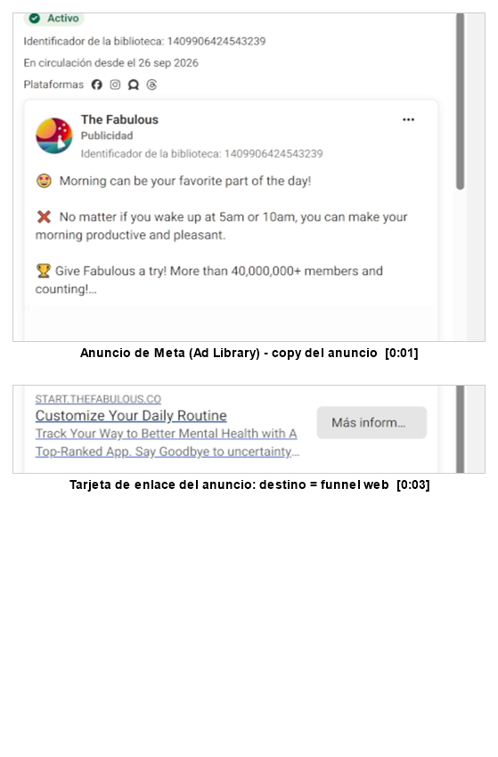

*Contexto, no alcance:* el funnel arranca directo desde el CTA del anuncio, sin landing previa. El copy del anuncio ("Morning can be your favorite part of the day!") y el del primer paso ("You're not lazy, you might be burning out.") no coinciden: la continuidad de mensaje anuncio→funnel queda a decisión del equipo de marketing de Bloom.

### 1.3 Corrección de aspecto — lee esto antes de medir nada

La grabación está **comprimida horizontalmente ≈ 0.81×**. Evidencia (elementos que son círculos por diseño): anillo del temporizador 30×37 px (0.81), badge de check 32×40 (0.80), burbuja "You" 72×88 (0.82), avatares y checkboxes igual. Consecuencias:

- Todas las imágenes de `images/` ya están **corregidas ×1.2346 en horizontal**. Los círculos se ven redondos y el texto con proporciones naturales. **No reproduzcas óvalos ni tipografías condensadas.**
- Las medidas de este documento están en **px CSS aproximados** con la hipótesis *card de 375 px de ancho*: `x_css ≈ x_video × 1.25`, `y_css ≈ y_video × 1.0`. Tolerancia ±3 %. Si prefieres otro ancho de card (p. ej. 390), conserva las **proporciones** (alto de opción ≈ 0.19 × ancho de card, alto de CTA ≈ 0.14 ×, padding lateral ≈ 0.056 ×).
- Los frames crudos no se incluyen; si necesitas uno exacto, extráelo del video con `ffmpeg -ss <t> -i "2026-10-29 01-53-06.mkv" -frames:v 1` y aplica ×1.2346 en horizontal.

### 1.4 Convenciones

- `#NN` = paso del funnel (§3). `[m:ss]` = momento aproximado del video (±1 s).
- **Números rojos** dentro de una imagen ↔ leyenda numerada justo debajo de esa imagen.
- Colores muestreados del video (H.264, ±3 niveles por canal): tómalos como tokens de partida, no como verdad absoluta.
- `{{brand}}` = nombre del producto (aquí **Bloom**; en la referencia "Fabulous"). `{{audience}}` = `men | women | people`.

---

## 2. Guardrails (no negociables)

1. **Marca y assets de terceros.** No copies el nombre/logo "Fabulous", la ilustración "You + orbe", el mapa con avatares, los avatares orbitales, el cerebro, los íconos 3D de los popups, ni la ilustración del perfil. Usa assets propios de Bloom o placeholders neutros marcados `TODO(content)`.
2. **Claims y credenciales.** No publiques como propios: "30 million men", "40,000,000+ members", los logos de prensa (The New York Times, WIRED, Forbes, girlboss, healthline), los logos de universidades (Stanford, Duke, Harvard) ni el revisor experto ("Jazmin Quill, MSc · Co-founder, Stanford Psych One Program"). En la config llevan `claimRef`: **no se renderizan** hasta que el usuario aporte evidencia (§9.1).
3. **Testimonios.** Los tres del loader (Alice L., Tara M., Remi L.) son de la referencia. Sólo se muestran testimonios reales de usuarios de Bloom, con permiso.
4. **Datos sensibles.** El paso #12 pregunta por ADHD y el perfil (#36) etiqueta "Manage ADHD" / "High level of negative effects". Es información de salud: pide consentimiento explícito, política de privacidad visible y evita lenguaje diagnóstico ("posible", "no es consejo médico").
5. **Suscripción y precios.** Mantén (y hazlo legible) el texto que aclara el precio de renovación y cómo cancelar. Los precios tachados deben corresponder a un precio previo real. El total del checkout debe coincidir **siempre** con el plan elegido (§9.3).
6. **Urgencia.** El temporizador "Discount reserved for 15:00" sólo es válido si el descuento realmente vence y no se reinicia al recargar. Impleméntalo detrás de un flag (`paywall.countdown.enabled`).
7. **Imágenes de referencia.** Viven sólo en `docs/`. No las incluyas en el bundle del producto.
8. **Privacidad del material fuente.** No reintroduzcas el email, el nombre ni el medio de pago del video en código, fixtures ni tests.

---

## 3. Mapa del funnel (42 pasos)

Tipos: `intro` · `single` (una opción, avanza solo) · `multi` (checkboxes + Continue) · `wand` (interactivo) · `inter` (pantalla intermedia) · `summary` · `loader` · `capture` · `loading` · `paywall` · `checkout`.
Conjuntos de opciones: **FREQ4** = Always · Often · Sometimes · Rarely — **YSN** = Yes · Sometimes · No — **OSN** = Often · Sometimes · Never.

| # | ≈t | Tipo | Copy de referencia (resumen) | Opciones / elementos | Fase |
|---|---|---|---|---|---|
| 01 | 0:06 | intro | "You're not lazy, you might be burning out." | CTA *Continue →* · reveal escalonado | 3 |
| 02 | 0:16 | single | How often do you feel mentally or physically drained? | FREQ4 | 2 |
| 03 | 0:25 | single | Do you overthink? | FREQ4 | 2 |
| 04 | 0:28 | single | Do you sleep poorly? | FREQ4 | 2 |
| 05 | 0:30 | single | Do you skip self-care? | FREQ4 | 2 |
| 06 | 0:46 | single | Do you feel like you spend too much time on your phone? | FREQ4 | 2 |
| 07 | 0:49 | single | Do you feel like you're constantly juggling too much and still falling behind? | YSN | 2 |
| 08 | 0:54 | wand | If you had a magic wand… · Tap 3 things you'd make vanish | 5 burbujas; elegir 3 | 4 |
| 09 | 1:07 | single | How often do you procrastinate on important tasks? | FREQ4 | 2 |
| 10 | 1:39 | single | How often do you find yourself restarting a habit? | 4 labels largos | 2 |
| 11 | 1:44 | single | Do you have trouble concentrating or staying focused? | FREQ4 | 2 |
| 12 | 1:50 | single | Do you have ADHD or do you suspect you have it? (+ subtítulo) | 3 · **dato sensible** | 2 |
| 13 | 1:54 | single | Do you feel like there's untapped potential within you? | Yes · Sometimes · Not really | 2 |
| 14 | 2:18 | single | When was the last time you felt fully in control of your life? | This week · A few weeks ago · Months ago · I'm not sure I ever have | 2 |
| 15 | 2:34 | single | What is your gender? (+ subtítulo) | Female · Male · Non-binary → **personaliza `{{audience}}`** | 2 |
| 16 | 2:36 | single | What is your age? | Under 20s · 20s · 30s · 40s · 50+ | 2 |
| 17 | 2:51 | inter | The Science of a Better You | mapa + prensa + "Join over 30 million {{audience}}" | 3 |
| 18 | 2:53 | single | Do you tend to put others' needs before your own? | OSN | 2 |
| 19 | 2:56 | single | Do others expect too much of you? | OSN | 2 |
| 20 | 3:10 | single | Do you find it hard to say 'no' to others? | OSN | 2 |
| 21 | 3:13 | multi | Which of these do you tend to sacrifice for others? | Sleep · Nutrition · Alone time · Your own goals · Emotional space | 2 |
| 22 | 3:24 | multi | What is currently missing from your life? | Motivation · Structure · Support from others · A clear plan · Time · Belief in myself | 2 |
| 23 | 3:38 | single | What's one thing you wish others understood about your struggles? | 4 labels | 2 |
| 24 | 3:44 | single | Have you ever tried building habits but couldn't stick with them? | Yes, many times · A few times · Never really tried | 2 |
| 25 | 3:49 | inter | It's a match. | animación Venn + check | 3 |
| 26 | 3:58 | inter | You are not alone | avatares orbitales · "30 million {{audience}}" | 3 |
| 27 | 4:00 | multi | Who are you doing this for? | Myself · My family · My future self · Someone who believes in me · I don't know yet | 2 |
| 28 | 4:04 | single | Do you tend to lose motivation easily? | Yes · No · I haven't tried yet | 2 |
| 29 | 4:06 | single | Did you hear about {{brand}} from an expert? | Yes · No | 2 |
| 30 | 4:11 | inter | {{brand}} was developed using evidence-based psychological practices | 3 logos de universidades | 3 |
| 31 | 4:13 | inter | Your plan will be reviewed by an expert | tarjeta del revisor | 3 |
| 32 | 4:19 | single | How would you describe your relationship with self-discipline? | I have none · It comes in phases · I'm usually pretty structured | 2 |
| 33 | 4:24 | single | In order to live a better life, what do you think you need most? | More energy · Stronger habits · Better focus · Inner peace | 2 |
| 34 | 4:26 | multi | What would success look like for you in 30 days? | 5 opciones (labels de 2 líneas) | 2 |
| 35 | 4:33 | single | What's your biggest motivation to start now? | 4 labels | 2 |
| 36 | 4:42 | summary | Summary of your Well-being Profile | meter + alerta + 4 tiles | 5 |
| 37 | 4:46 | loader | Creating your Personalized Plan | 3 barras · 2 preguntas interrumpen · testimonios | 5 |
| 38 | 5:15 | capture | Please enter your email · To save your progress… | email | 6 |
| 39 | 5:18 | capture | One last thing, what do your friends call you? | nombre · CTA pasa a "Please wait…" | 6 |
| 40 | 5:21 | loading | (pantalla en blanco ≈ 4–5 s) | — | 6 |
| 41 | 5:25 | paywall | Choose your plan | 3 planes · timer 15:00 | 7 |
| 42 | 5:45 | checkout | Your plan is ready. Let's make it real. | PayPal · Google Pay · tarjeta | 7 |

**Reglas globales**

- **Header (logo + barra de progreso)** visible en `single`, `intro`, `capture`. Oculto en `multi`, `inter`, `wand`, `summary`, `loader`, `paywall`, `checkout`.
- **Progreso lineal por paso.** Medido sobre 26 frames: el relleno crece ≈ 6.85 px (de 266) por paso, `progreso(#n) = (n − 1) / 39` para n = 1…38. Los pasos sin header también cuentan (p. ej. de #16 a #18 el relleno salta dos pasos por el #17). El paso #39 comparte el valor del #38 (≈ 94.9 %).

  | Paso | #02 | #03 | #07 | #09 | #16 | #24 | #28 | #35 | #38/#39 |
  |---|---|---|---|---|---|---|---|---|---|
  | Relleno medido (px de 266) | 6 | 13 | 40 | 54 | 102 | 157 | 184 | 232 | 246* |
  | Fracción | 2.3 % | 4.9 % | 15 % | 20 % | 38 % | 59 % | 69 % | 87 % | 94.6 % |

  \* medido sobre pista de 260 px.
- **Personalización de copy por género.** Tras elegir `Male` en #15, #17 y #26 dicen "men". `Female → women` y `Non-binary → people` están **inferidos**, no observados.
- **Fondos por tipo de pantalla:** lavanda `#ECEAFF` (intro, preguntas, match) · lavanda claro `#F5F4FD` (intermedias sin card, resumen, loader) · casi negro `#0D0E11` (wand) · gris cálido `#F3F1EF` (email/nombre) · blanco (paywall, checkout).
- **Auto-avance:** los `single` avanzan al elegir; no hay botón "Next" ni flecha "Back" en el header.

---

## 4. Sistema visual

### 4.1 Tokens de color (muestreados)

| Token propuesto | Valor | Uso |
|---|---|---|
| `--bg-page-lilac` | `#ECEAFF` | Fondo de intro, preguntas y match |
| `--bg-card` / `--bg-page-soft` | `#F5F4FD` | Card del quiz; fondo de intermedias, resumen y loader |
| `--bg-page-dark` / `--bg-wand-col` | `#0D0E11` / `#EDEBF9` | Wand: fuera de la columna / columna |
| `--bg-page-warm` | `#F3F1EF` | Email y nombre |
| `--surface-option` | `#FFFFFF` | Opción en reposo |
| `--surface-option-active` | `#E4E1FD` (single) · `#E3E0FE` (multi) | Hover / pressed / seleccionada |
| `--progress-track` / `--progress-fill` | `#FFFFFF` / `#BAB3FD` | Barra de progreso |
| `--brand-indigo` | `#3424B8` | CTA primario; texto de intermedias |
| `--brand-violet` | `#6454FE` | Checkbox marcado, íconos del resumen |
| `--accent-violet-soft` | `#6C5FFF` · `#6657E3` | Cifra "Join over…", énfasis "an expert" |
| `--ink-900` | `#13171B` | Títulos |
| `--ink-700` | `#353334` | Label de opción |
| `--ink-600` | `#5C5F73` | Subtítulo del intro |
| `--ink-400` | `#9CA4B0` | Contador del wand |
| `--you-border` | `#6F58DB` | Borde de la burbuja "You" |
| `--you-fill` | `#F9D9AA → #F4CEB8` | Degradado de la burbuja "You" |
| `--success-green` | `#11B786` | Badge de check del match |
| `--meter-1…6` | `#7BD5F1 · #9DF6A7 · #E6E881 · #F0B76D · #EF845D · #F06253` | Medidor del resumen (pista `#F3F1EF`) |
| `--alert-bg` / `--alert-icon-bg` / `--alert-icon-fg` | `#FBDFE6` / `#FEB2B6` / `#FC4247` | Alerta "HIGH level"; pill "High" fondo `#FEDDDE` |
| `--step-1/2/3` | `#35BA9C` · `#F6A76C` · `#E99282` | Barras del loader y sus checks |
| `--overlay-loader` | `rgba(0,0,0,.5)` | Backdrop de las preguntas del loader |
| `--paywall-accent` | `#7A60FF` | Ribbon, borde seleccionado, arco del timer, badge SAVE |
| `--paywall-selected-bg` | `#E7E2FD` | Card de plan seleccionada |
| `--paywall-grad` | `#636EFE → #9C7BFE → #D085FD` (izq → der) | CTA "Continue" y "Get my Plan" |
| `--price-struck` / `--price-struck-red` | `#818F9E` / `#BD2128` | Precio original / por día original |
| `--checkout-overlay` | `rgba(0,0,0,.6)` | Backdrop del modal de pago |
| `--paypal-gold` | `#FCC237` (oficial `#FFC439`) | Botón PayPal listo |
| `--safe-pill-bg` | `#BEF7F1` | Pill "Pay Safe & Secure" |
| Burbujas wand (tono medio) | `#6C5FE0` Anxiety · `#4F78C4` Self-doubt · `#9A5BBE` Burnout · `#D2648E` Loneliness · `#E08A4A` Lack of motivation | Con highlight especular y glow del mismo matiz |

### 4.2 Tipografía (aproximada; no se pudo identificar la fuente)

| Uso | Familia sugerida | Tamaño / interlínea | Peso |
|---|---|---|---|
| Titular emocional (intro, match, wand) | Serif de texto (Source Serif 4 / Newsreader / Lora) | 26/31 · 24/30 · 22/28 | 500 |
| Título de pregunta | Sans (Inter / Figtree) | 20/24 | 700 |
| Subtítulo de pregunta | Sans | 14/17 | 400 |
| Label de opción | Sans | 15/20 | 400 |
| CTA | Sans | 17/24 | 600 |
| Título de intermedia | Sans | 21/26, color indigo | 700 |
| Cuerpo de intermedia | Sans | 15/23, color indigo | 500 |
| Título paywall / plan | Sans | 26/32 · 18/22 | 700 |
| Dígito grande "por día" | Sans | 44 (el "0") + 16 (`$` y decimales) | 600 |
| Legal | Sans | 12/16 | 400 |

Si Bloom ya tiene tipografía de marca, úsala y conserva tamaños/jerarquía.

### 4.3 Layout y medidas (px CSS ≈)

| Elemento | Valor | Notas |
|---|---|---|
| Card del quiz | 375 × (viewport − 62) → 648 @ viewport 710 | radio ≈ 32, margen sup. 32 / inf. 30, sin sombra |
| Padding lateral | opciones 21 · CTA/multi 25 | |
| Header | logo centrado a +42 del borde sup. de la card, alto 26 | barra de progreso a +75, alto 3, ancho 333, radio 2 |
| Bloque de título | arranca a +124; interlínea 24; subtítulo a +4 | opciones a +24 bajo el título |
| Opción `single` | 333 × 72, gap 9, radio ≈ 12 | label abajo-izquierda, padding-left 16, baseline ≈ 24 sobre el borde inf. |
| Fila `multi` | 325 × 56 (crece con 2 líneas), gap 9 | checkbox 24×24 radio 6 a +17; label a +59 |
| CTA | 325 × 52, radio ≈ 10; margen inf. 26 | intro/interstitial: 47–53 de alto |
| Columna de contenido | 325 (CTA y texto) | intro, interstitials, match |
| Columna wand | 365 × alto completo | sobre fondo `#0D0E11` |
| Contenedor del resumen | 520 | tiles 256×46, CTA 274×52 |
| Barras del loader | 270 × 44, gap 12, radio 22 | |
| Modal de pregunta del loader | 375 × 648 (igual a la card) | botones 157×60, gap 9 |
| Contenido del paywall | 457 de ancho | header sticky 98 de alto |
| Modal de checkout | 430 × 630 máx., scroll interno | botones de pago 390 × 54 |

Layout vertical: `single` se ancla arriba (header → título → opciones). `multi` y `capture` centran el bloque verticalmente en el espacio libre sobre el CTA (con ~6 px de sesgo hacia arriba). Las intermedias reparten: título/ilustración arriba, texto + CTA abajo.

### 4.4 Movimiento (tiempos observados)

| Transición | Duración observada |
|---|---|
| Salida de contenido entre pasos | ≈ 400 ms (opacidad 1→0; la card permanece) |
| Hueco entre salida y entrada | ≈ 150–200 ms |
| Entrada del paso siguiente | ≈ 300 ms (opacidad 0→1) |
| CTA de intermedias | deshabilitado (≈ 35 % de opacidad) ≈ 0.5 s tras montar, luego habilitado |
| Hover/click en CTA | la flecha "→" se alarga a "⟶" (≈ 150 ms) |
| Hover de opción | fondo `#E4E1FD`, ≈ 120 ms (estimado) |
| Intro → primera pregunta | ≈ 2.3 s de vacío en el original (probable latencia de red). **No replicar:** objetivo ≤ 400 ms |

Respeta `prefers-reduced-motion`: sustituye movimientos por fundidos cortos.

---

## 5. Especificación por pantalla

### 5.1 Shell: card, header y progreso

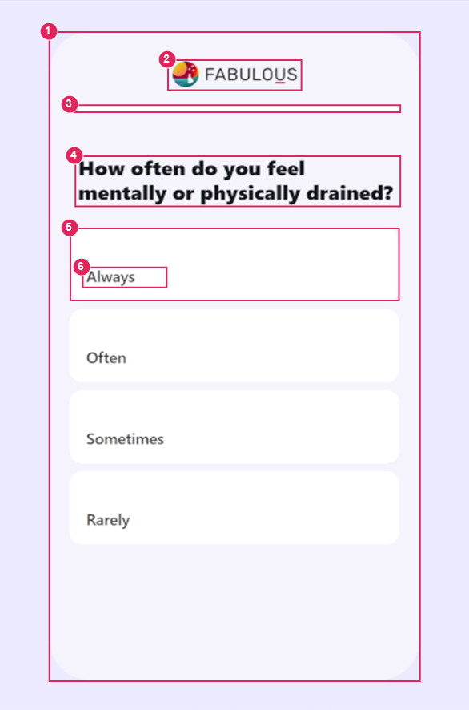

1. Card contenedora (fondo `#F5F4FD`, radio ≈ 32).
2. Logo de marca centrado (slot para logo de Bloom).
3. Barra de progreso (pista blanca, relleno `#BAB3FD`).
4. Título de la pregunta.
5. Opción (tarjeta blanca de 72 px).
6. Label de la opción (abajo-izquierda).

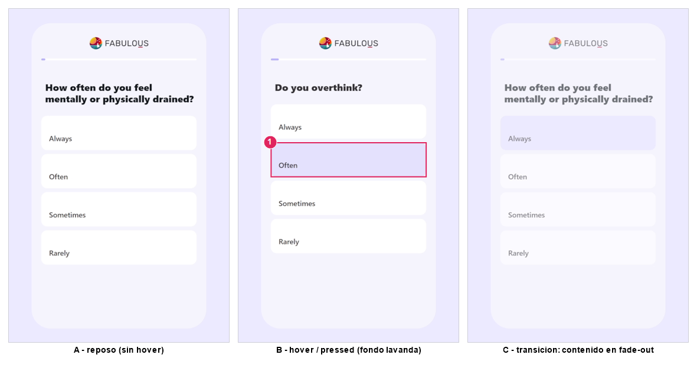

- **A** reposo · **B** hover/pressed: fondo lavanda `#E4E1FD` · **C** transición: el contenido se desvanece y la card permanece.
- Mobile (< 480 px): supuesto, la card ocupa todo el ancho, sin radio ni margen externo (no se observó).

### 5.2 Intro (#01)

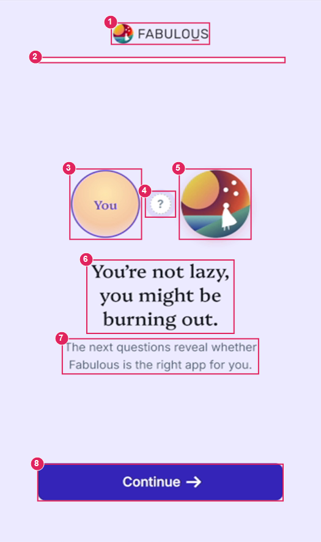

1. Logo · 2. Barra de progreso (≈ 0 %) · 3. Burbuja "You" (círculo ≈ 90 px, degradado `#F9D9AA → #F4CEB8`, borde `#6F58DB`) · 4. Chip "?" (≈ 34 px, círculo blanco con borde punteado) · 5. Orbe de marca (círculo ≈ 90 px) · 6. Titular serif en 3 líneas · 7. Subtítulo (2 líneas, `#5C5F73`) · 8. CTA "Continue →".

**Sin card** (fondo `#ECEAFF` a pantalla completa), contenido en columna de 325 px. El grupo ilustración + texto queda centrado entre el header y el CTA; el CTA se ancla abajo.

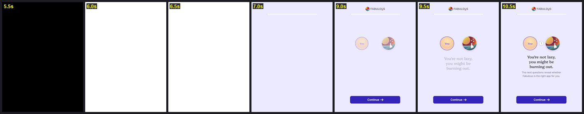

Secuencia observada: pantalla negra (hasta ≈ 5.9 s) → blanco (≈ 6.0–6.8 s) → fondo lavanda con pista de progreso (≈ 7.0 s) → logo → ≈ 1.8 s después fade-in de círculos + titular + CTA (≈ 0.5 s) → chip "?" y subtítulo (≈ 9.5 s). El negro/blanco inicial es carga de página: en Bloom usa un splash con el fondo lavanda desde el primer pixel.

**Aceptación:** reveal escalonado de ≈ 1 s sin parpadeos; CTA siempre visible; clic → fundido a #02.

### 5.3 Pregunta single-select (#02–#07, #09–#16, #18–#20, #23, #24, #28, #29, #32, #33, #35)

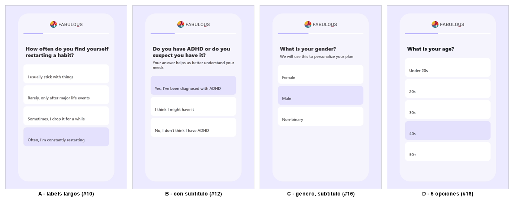

- **A** labels largos (se ajustan a 1 línea) · **B** con subtítulo (14 px, debajo del título) · **C** género · **D** 5 opciones.

**Comportamiento**

1. Hover: fondo `#E4E1FD`. Tap/clic: estado seleccionado inmediato.
2. ≤ 150 ms después: guarda la respuesta, anima salida (≈ 400 ms) y entrada del siguiente paso (≈ 300 ms).
3. No hay "Next" ni "Back" visibles. Teclado: `role="radiogroup"`, flechas mueven, `Enter`/`Space` eligen.
4. Una sola selección; la respuesta anterior (si el usuario vuelve atrás) aparece marcada.

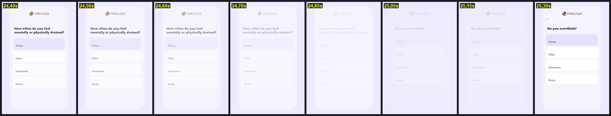

*Salida: 24.40 → 24.85 s · entrada: 25.05 → 25.30 s. La card (contenedor) no se anima; sólo su contenido.*

**Decisión de diseño (ver §9.1-D5):** en la referencia el label queda abajo-izquierda con mucho aire arriba (la opción mide 72 px). Probablemente reserva un slot de ícono/emoji que no cargó. Implementa `OptionCard` con slot `icon` opcional y token `--option-label-align: end` para igualar la referencia; centrar el label es una alternativa válida si el usuario lo prefiere.

**Aceptación:** misma jerarquía, medidas de §4.3, estados A/B/C, auto-avance y barra de progreso según §3.

### 5.4 Pregunta multi-select (#21, #22, #27, #34)

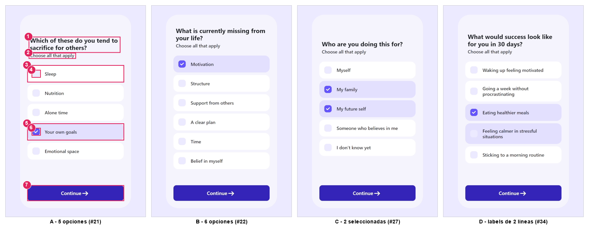

1. Título (sin header en estas pantallas) · 2. Subtítulo "Choose all that apply" · 3. Fila (blanca) · 4. Checkbox sin marcar (fondo `#ECEAFF`, sin borde) · 5. Fila seleccionada (`#E3E0FE`) · 6. Checkbox marcado (`#6454FE` con check blanco) · 7. CTA "Continue →".

- Toggle por fila; sin límite de selección. Bloque centrado verticalmente sobre el CTA.
- Labels de 2 líneas (#34) agrandan la fila.
- **Supuesto:** el CTA se ve deshabilitado (≈ 35 %) con 0 selecciones y se habilita con ≥ 1 (no se observó con 0 elegidas). Aceptación: `aria-checked`, `Space` alterna, `Enter` en el CTA avanza.

### 5.5 Pantalla interactiva "Magic wand" (#08)

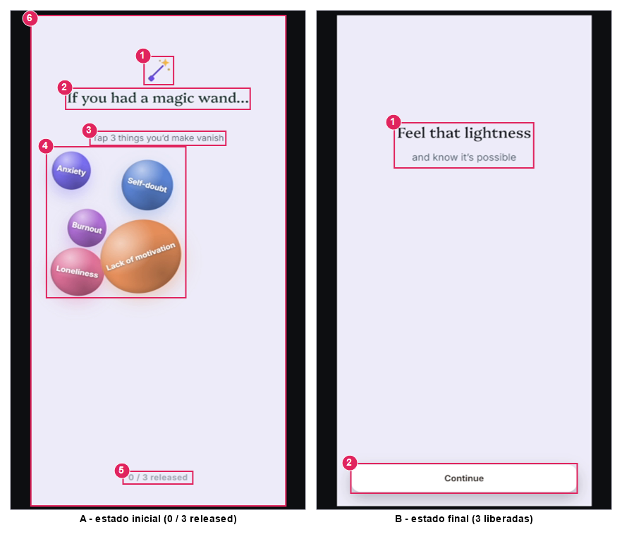

**A (inicio):** 1. Ícono de varita con destellos · 2. Título serif "If you had a magic wand…" · 3. Subtítulo "Tap 3 things you'd make vanish" · 4. Cluster de 5 burbujas · 5. Contador "0 / 3 released" · 6. Columna (365 px, alto completo) sobre fondo oscuro.
**B (final):** 1. Título "Feel that lightness" + subtítulo "and know it's possible" · 2. CTA **blanco** "Continue" (325×40, sombra suave).

**Burbujas** (diámetro ≈ px CSS): Anxiety 55 · Self-doubt 72 · Burnout 55 · Loneliness 75 · Lack of motivation 112. Esferas con degradado radial, highlight especular, glow del mismo matiz (blur ≈ 14 px) y label blanco en negrita rotado entre ±10° y ±25°. Colores en §4.1.

**Movimiento idle:** cada burbuja deriva lento (amplitud ≈ ±8 px, período 3–6 s) con leve rotación y **colisión suave** (se pueden superponer un poco). Implementa con `requestAnimationFrame` y resortes; sin librerías pesadas. El área táctil mínima es 44 px aunque la burbuja sea menor.

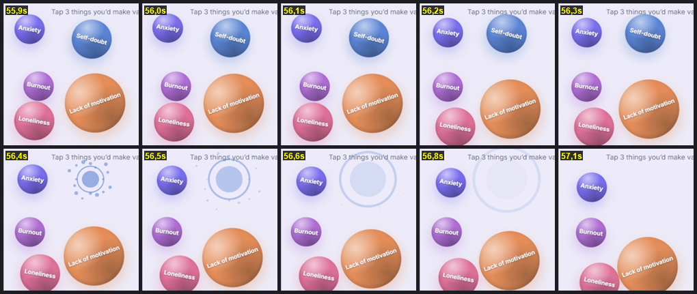

**Al tocar (secuencia 56.3 → 57.1 s):** la burbuja se contrae en ≈ 150 ms a un disco plano del mismo color; alrededor aparece un anillo de ≈ 10 partículas que se expande hasta ≈ 2.5× y se desvanece en ≈ 700 ms; el resto del cluster se reacomoda en ≈ 400 ms. El contador sube **al instante** ("1 / 3 released"). Tras 3 liberaciones no se puede tocar más.

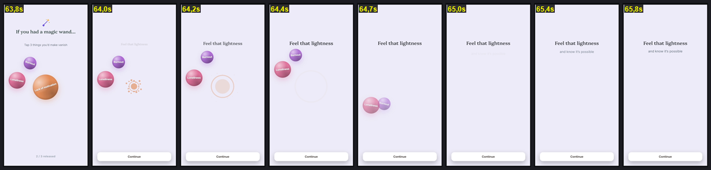

**Tercera liberación (63.8 → 65.8 s):** estalla la burbuja (partículas del color de la burbuja); el título se funde a "Feel that lightness" (≈ 300 ms); las burbujas restantes **derivan hacia abajo y se desvanecen** (≈ 600 ms); el subtítulo aparece ≈ 0.9 s después (≈ 400 ms); el CTA blanco aparece desde el estallido y queda fijo abajo.

**Datos:** guarda `wand.released = [labels…]` en orden de toque (alimenta "Trigger" del resumen, §6.5). **A11y:** cada burbuja es un `<button>` con nombre accesible; `aria-live="polite"` anuncia "1 of 3 released"; con `prefers-reduced-motion` no hay deriva y el estallido es un fundido.

**Aceptación:** 5 burbujas flotando, 3 toques exactos, contador, estallido, cierre con CTA; sin saltos de layout.

### 5.6 Pantallas intermedias (#17, #25, #26, #30, #31)

Estructura común: columna de 325 px, **sin card**, fondo `#F5F4FD` (el match usa `#ECEAFF`), título arriba, bloque de texto + CTA anclado abajo. CTA deshabilitado ≈ 0.5 s tras montar. Hover/clic: flecha "→" → "⟶".

**#17 Science**
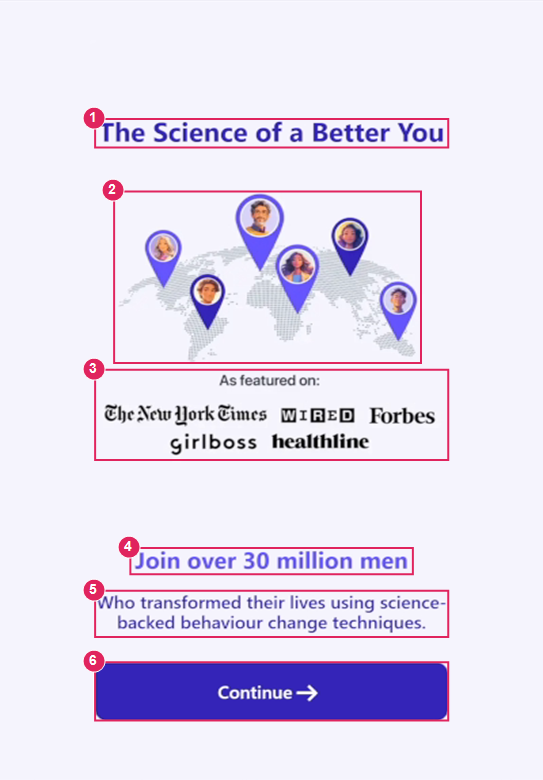
1. Título (indigo, 21 px bold) · 2. Mapa punteado con 6 pines con avatar · 3. "As featured on:" + logos de prensa en 2 filas · 4. Cifra (`#6C5FFF`) "Join over 30 million {{audience}}" · 5. Cuerpo indigo · 6. CTA.
Logos de prensa y cifra: **sólo con evidencia** (§2). Sin ella, usa texto honesto o suprime el bloque (flag).

**#25 Match**
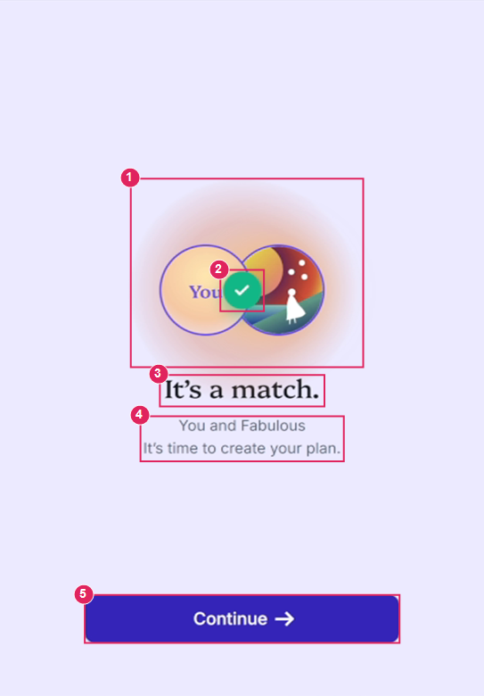
1. Glow radial cálido (≈ 190 px) + dos círculos solapados (Venn) · 2. Badge de check verde `#11B786` · 3. Titular serif "It's a match." · 4. Subtexto en 2 líneas · 5. CTA.

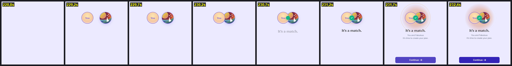
*Secuencia: círculos separados (229.2 s) → se deslizan y se superponen (≈ 1 s después) → aparece el check + titular gris que se oscurece (≈ 0.5 s) → subtexto, glow y CTA (≈ 0.5 s).*

**#26 You are not alone**
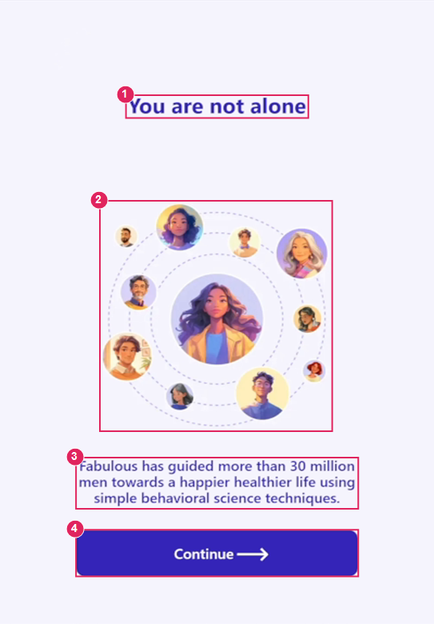
1. Título · 2. Avatar central (≈ 104 px) + 10 satélites en 2 órbitas punteadas · 3. Texto indigo de 3 líneas ("… more than 30 million {{audience}} …") · 4. CTA. Ilustración propia obligatoria.

**#30 Evidencia**
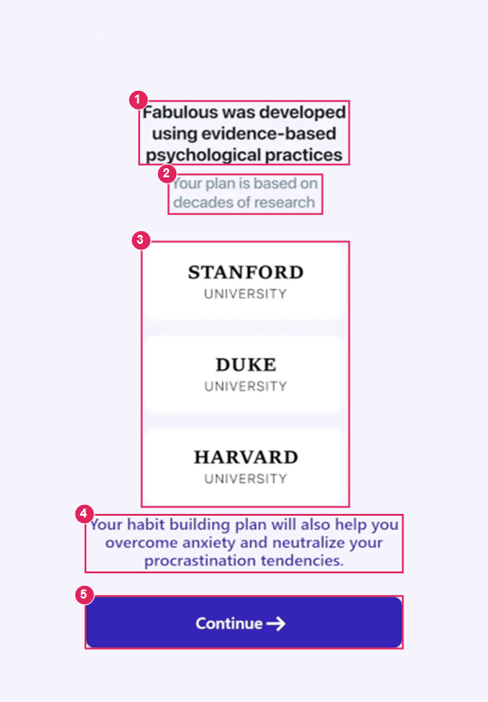
1. Título (oscuro, 18 px bold) · 2. Subtítulo gris `#838B95` · 3. Tres tarjetas blancas (≈ 212×78, radio 12) con wordmark serif + "UNIVERSITY" · 4. Texto indigo · 5. CTA. **No uses logos de universidades sin acuerdo.**

**#31 Revisión experta**
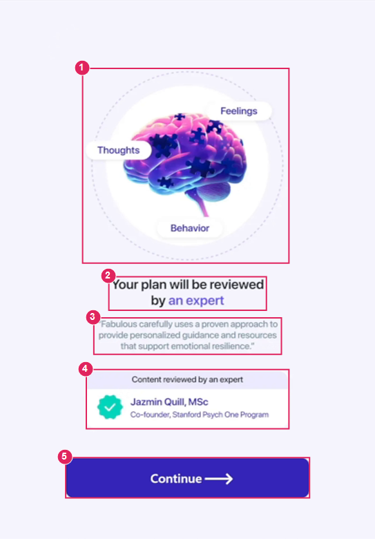
1. Anillo punteado + círculo blanco con ilustración y 3 chips (Thoughts / Feelings / Behavior) · 2. Titular ("an expert" en `#6657E3`) · 3. Cita gris de 3 líneas · 4. Tarjeta del revisor (cabecera lavanda "Content reviewed by an expert", badge verificado, nombre en negrita, cargo) · 5. CTA. **El revisor debe ser real** (§2).

**Aceptación (todas):** layout igual, CTA con delay y hover de flecha, sin assets de la referencia, claims bajo flag.

### 5.7 Resumen de perfil (#36)

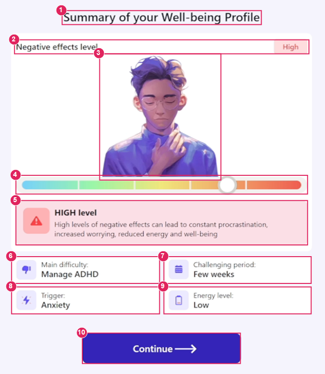

1. Título (22 px, peso normal) · 2. Fila "Negative effects level" + pill "High" (fondo `#FEDDDE`, texto rojo) · 3. Ilustración de una persona (sale personalizada por género en la referencia) · 4. Medidor de 6 tramos en degradado cian→rojo con perilla blanca (≈ 74 %) · 5. Alerta rosa "HIGH level" + 2 líneas · 6–9. Tiles 2×2: **Main difficulty** (Manage ADHD) · **Challenging period** (Few weeks) · **Trigger** (Anxiety) · **Energy level** (Low) · 10. CTA "Continue →".

- Contenedor de 520 px; tarjeta blanca de radio ≈ 16; tiles blancos de 256×46 con ícono en cuadro `#ECEAFF`.
- Es la primera pantalla "de resultado": entra con la ilustración animada (fundido ≈ 400 ms); el medidor llega a su posición con una animación breve (no observada, estimar 600 ms).
- Reglas de derivación: **no se ven en el video**; propuesta en §6.5.

### 5.8 Loader "Creating your Personalized Plan" (#37)

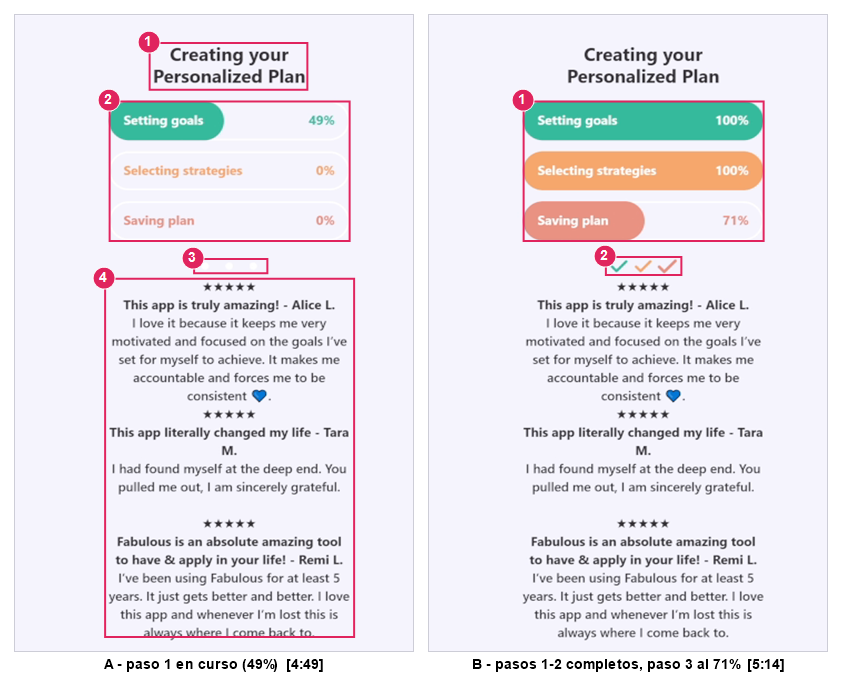

**A** 1. Título · 2. Tres barras de progreso (pista blanca con borde, relleno del color del paso) · 3. Fila de 3 puntos (blancos, casi invisibles) · 4. Testimonios. **B** 1. Barras completas · 2. Los puntos se reemplazan por checks del color de cada paso (✓ verde, ✓ naranja, ✓ salmón).

- El texto de la barra pasa de color-del-paso (sobre la pista) a blanco (sobre el relleno); el % va alineado a la derecha.
- Los testimonios se ven **apilados** (3 bloques centrados: ★★★★★, título en negrita, cuerpo). Probablemente era un carrusel sin inicializar; replica la lista vertical (paridad) o implementa carrusel, ambos aceptables. La página hace scroll.

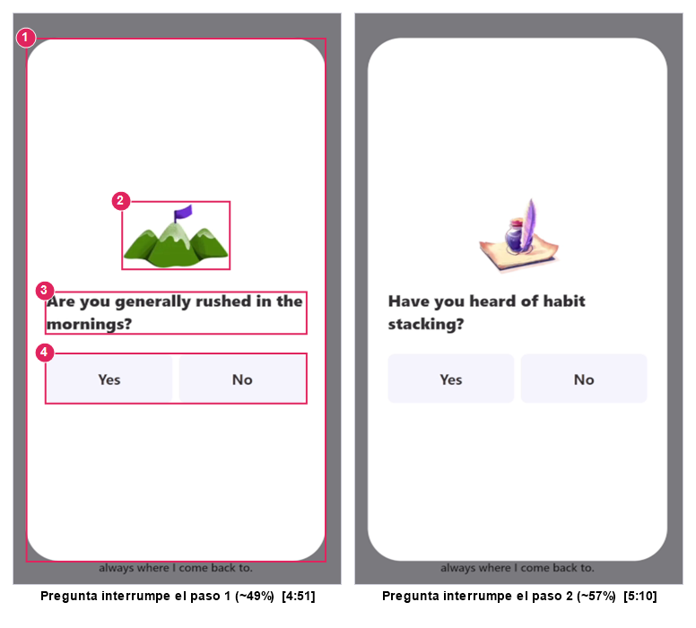

1. Modal (375×648, blanco, radio ≈ 32) sobre backdrop `rgba(0,0,0,.5)` · 2. Ícono 3D (montaña con bandera / pluma y tintero) · 3. Pregunta en negrita, alineada a la izquierda · 4. Botones **Yes / No** lado a lado (fondo `#F5F4FD`; en hover/pressed se vuelven oscuros ≈ `#2F2D32` con texto blanco).

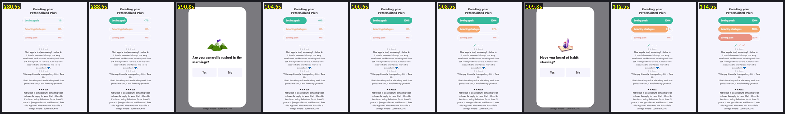

| Tiempo | Evento |
|---|---|
| 286.5 s | "Setting goals" 1 % |
| 287.5 → 289.5 s | 33 % → 47 % → 49 %: curva con *ease-out*, frena cerca de 50 % |
| ≈ 290.5 s | **Modal 1** "Are you generally rushed in the mornings?" — progreso en pausa |
| ≈ 303.5 s | Respuesta (aquí tardó 13 s) → reanuda: 60 % → 82 % → 100 % en ≈ 2.3 s |
| 307.5 → 308.5 s | "Selecting strategies" 41 % → 57 % |
| ≈ 309.5 s | **Modal 2** "Have you heard of habit stacking?" — pausa |
| ≈ 311.5 s | Respuesta → 97 % en ≈ 1 s → 100 % |
| 313.5 → 314.5 s | "Saving plan" 10 % → 71 % → 95 % |
| ≈ 315 s | Termina; fundido a #38 |

**Reglas:** progreso eased, no lineal; el modal 1 interrumpe el paso 1 a ≈ 50 %, el modal 2 interrumpe el paso 2 a ≈ 58 %; el progreso **no avanza** mientras el modal está abierto; responder cierra el modal y reanuda en ≤ 1 s. Las respuestas se guardan (`rushed_mornings`, `heard_habit_stacking`). Duración activa total ≈ 12–14 s sin contar respuestas.

**Aceptación:** 3 barras secuenciales con porcentajes enteros, checks por paso, 2 modales bloqueantes, testimonios (propios), transición automática a #38.

### 5.9 Captura de email y nombre (#38, #39, #40)

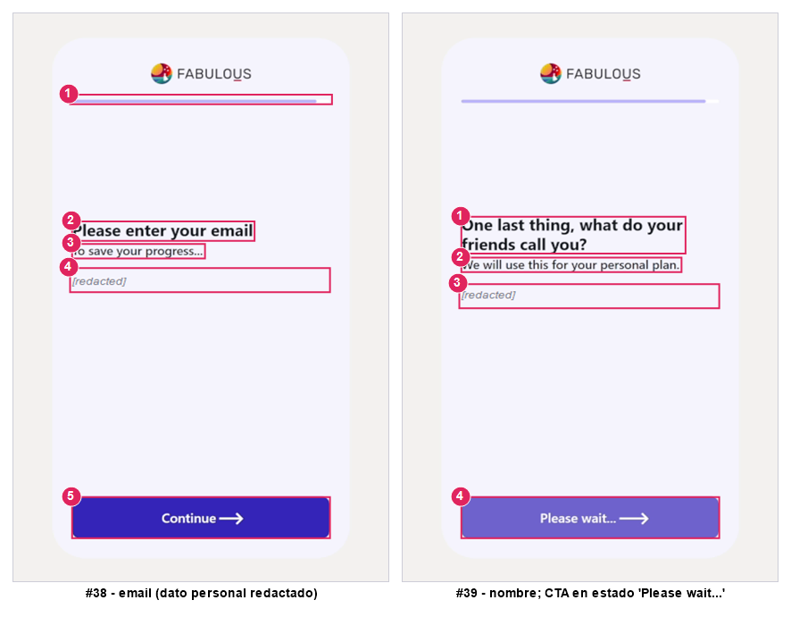

**#38** 1. Barra de progreso ≈ 95 % · 2. Título "Please enter your email" · 3. Subtítulo "To save your progress…" · 4. Campo de texto **sin caja visible** (texto + caret) · 5. CTA "Continue →".
**#39** 1. Título (2 líneas) · 2. Subtítulo "We will use this for your personal plan." · 3. Campo · 4. CTA que, al enviar, cambia a **"Please wait… ⟶"** con fondo más claro (`#6E62CC`).

- Fondo de página `#F3F1EF` (gris cálido), card como el quiz, logo + progreso visibles.
- Validación y errores: **no observados**. Propuesta: validar formato de email al enviar, `aria-invalid`, mensaje inline; nombre 1–40 caracteres.
- Recomendación (desviación consciente): añade subrayado o borde sutil al campo y un `placeholder`; el original no muestra afordancia de input.
- Tras el nombre hay una **pantalla en blanco de ≈ 4–5 s** (#40) antes del paywall: en Bloom usa un loader de marca ≤ 1.5 s y precarga el paywall.

### 5.10 Paywall (#41)

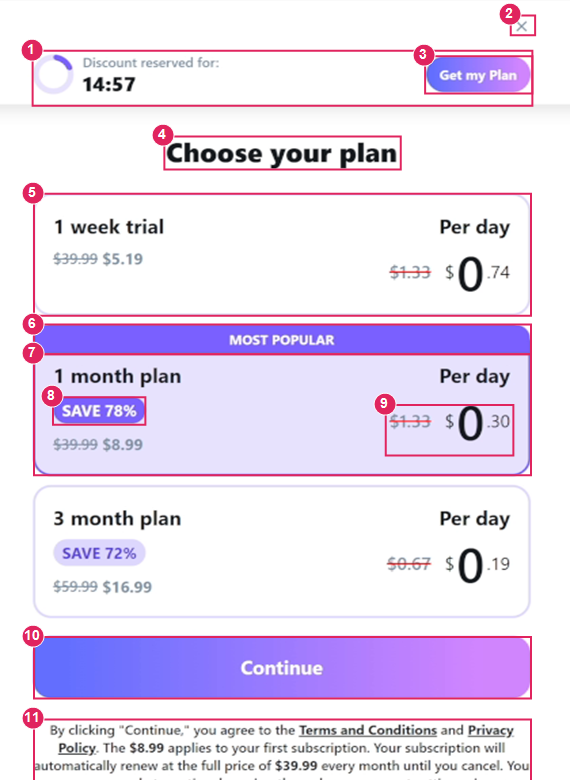

1. Header sticky (blanco, sombra inferior): anillo del timer + "Discount reserved for:" + cuenta regresiva `mm:ss` (arranca en 15:00) · 2. Cerrar × (comportamiento no observado) · 3. Pill "Get my Plan" (degradado) · 4. Título "Choose your plan" · 5. Card de plan no seleccionada (borde 2 px lavanda `#E2DEF8`) · 6. Ribbon "MOST POPULAR" (`#7A60FF`) · 7. Card seleccionada (fondo `#E7E2FD`, borde 2 px `#7A60FF`) · 8. Badge "SAVE 78 %" · 9. Precio por día: original tachado en rojo + `$` + "0" grande + decimales · 10. CTA "Continue" (píldora con degradado) · 11. Legal.

| Plan | Precio | Original | Por día (orig. → actual) | Badge |
|---|---|---|---|---|
| 1 week trial | $5.19 | $39.99 | $1.33 → $0.74 | — |
| **1 month plan** *(default, MOST POPULAR)* | $8.99 | $39.99 | $1.33 → $0.30 | SAVE 78 % |
| 3 month plan | $16.99 | $59.99 | $0.67 → $0.19 | SAVE 72 % |

Cálculos (verificados): `perDay = price / días` (7, 30, 90); `perDayOriginal = originalPrice / 30` (1 mes) y `/ 90` (3 meses); `ahorro = 1 − price / originalPrice` redondeado. Nota: el "por día original" del plan de 1 semana (`$1.33`) equivale a 39.99 / 30, o sea que toma el precio mensual como base de comparación; documéntalo en la config para que el equipo de precios lo confirme.

- **Selección:** card seleccionada = fondo `#E7E2FD` + borde `#7A60FF`. Default: 1 month. Tap en otra card la selecciona (≈ 150 ms).
- **Timer:** 15:00 al montar la pantalla; 1 s por tick; formato `mm:ss`. En la referencia el anillo mostraba un arco violeta corto que se achicaba apenas; impleméntalo como anillo que se vacía de 100 % a 0 % (o decorativo). Quedó congelado en 14:47 durante ≈ 5 s antes de abrir el modal (posible bloqueo de render): no replicar.
- **CTA:** se ve deshabilitado (≈ 15 % de opacidad) al montar la pantalla y de nuevo un instante hacia 5:35 sin causa visible (¿re-render?); luego habilitado. "Get my Plan" hace lo mismo que Continue (comportamiento no observado → default: scroll a los planes).
- **Legal (visible):** *By clicking "Continue," you agree to the Terms and Conditions and Privacy Policy. The $8.99 applies to your first subscription. Your subscription will automatically renew at the full price of $39.99 every month until you cancel. …* El texto completo continúa bajo el pliegue y no se ve. Genera la plantilla con el plan elegido.
- **Scroll:** la página scrollea (hay barra lateral) pero el video no baja: el contenido debajo del CTA es desconocido (§9.2).

**Aceptación:** 3 planes con cálculos correctos, default 1 mes, selección visible, timer, sticky header, legal dinámico, CTA.

### 5.11 Checkout (#42)

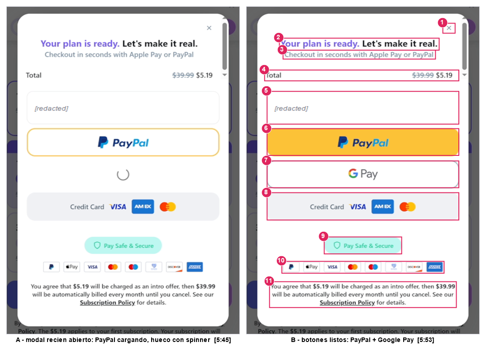

**A** (≈ 5:45, recién abierto): PayPal con borde amarillo (cargando) y un spinner donde irá Google Pay. **B** (≈ 5:53, ≈ 7–8 s después): botones listos.
1. Cerrar × · 2. Titular: "**Your plan is ready.**" (violeta `#7A60FD`) + " Let's make it real." · 3. Subtítulo "Checkout in seconds with Apple Pay or PayPal" (`#858E98`) · 4. Fila **Total**: precio original tachado + precio · 5. Campo email, **precargado** con el del paso #38 · 6. Botón **PayPal** (oro `#FCC237`) · 7. Botón **Google Pay** (blanco, borde 2 px `#AEB7BE`) · 8. Fila **Credit Card** (VISA · AMEX · Mastercard) sobre `#F0F1F4` · 9. Pill "Pay Safe & Secure" (`#BEF7F1`) · 10. Tira de logos de métodos de pago (PayPal, Apple Pay, Visa, Mastercard, Maestro, UnionPay, Discover, Amex) · 11. Legal: *You agree that $5.19 will be charged as an intro offer, then $39.99 will be automatically billed every month until you cancel. See our Subscription Policy for details.*

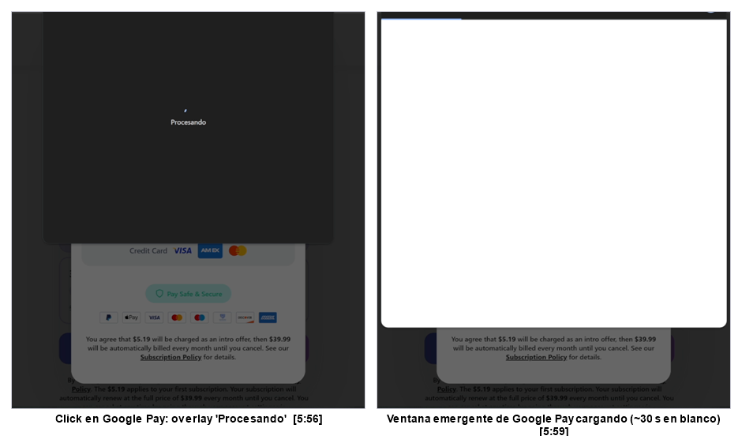

- Abre al pulsar *Continue* del paywall: backdrop `rgba(0,0,0,.6)`; el modal scrollea por dentro.
- Los botones de PayPal y Google Pay se montan **asíncronos** (≈ 7–8 s en el video; depende del SDK y de la red); mientras tanto muestra el borde/placeholder y un spinner. Objetivo en Bloom: botones visibles en < 2 s o skeleton claro. Apple Pay aparece sólo en dispositivos compatibles (el copy lo menciona; en el video no se ve).
- Pulsar Google Pay muestra el overlay oscuro "Procesando" (UI del proveedor) y luego una ventana emergente que permanece **≈ 30 s en blanco**; el video termina ahí. No hay estado de éxito ni de error observable.
- **No replicar el bug:** el modal mostró **$5.19** (plan de 1 semana) con el plan de **1 mes ($8.99)** resaltado. El total y el texto legal deben derivarse del plan elegido.
- Tarjeta: se muestra como fila/acordeón; el formulario no se abre en el video. Impleméntalo con el proveedor de pagos (Payment Element).

**Aceptación:** layout, estados A/B, email precargado, total correcto, botones asíncronos, cierre del modal, legal dinámico.

---

## 6. Arquitectura del funnel

### 6.1 Modelo de datos

Fuente de verdad: array de pasos tipado y *data-driven* (ver `funnel.reference.json`).

```ts
type Theme = 'lilac' | 'soft' | 'dark' | 'warm' | 'white';

interface BaseStep { n: number; id: string; theme: Theme; header: boolean; }
interface SingleStep extends BaseStep { type: 'single'; answerKey: string; title: string; subtitle?: string;
  options: string[]; }                                     // o optionSet: 'FREQ4' | 'YSN' | 'OSN'
interface MultiStep  extends BaseStep { type: 'multi';  answerKey: string; title: string; subtitle: string;
  options: string[]; minSelected: 1; }
interface WandStep   extends BaseStep { type: 'wand'; pick: 3; bubbles: string[]; finish: { title: string; subtitle: string }; }
interface InterStep  extends BaseStep { type: 'inter'; variant: 'science'|'match'|'not_alone'|'evidence'|'expert';
  ctaEnableDelayMs: number; claimRef?: string[]; }
interface LoaderStep extends BaseStep { type: 'loader'; progressSteps: { label: string; color: string }[];
  interrupts: { step: number; atProgress: number; title: string; options: string[]; answerKey: string }[]; }
// summary | capture | loading | paywall | checkout: ver el JSON
```

Estado global: `answers: Record<string, string | string[]>`, `wand.released: string[]`, `audience`, `profile`, `lead: { email, name }`, `selectedPlanId`, `paywallStartedAt`, `currentStepId`.

### 6.2 Navegación, persistencia y progreso

- Ruta `/s/:stepId`; el paso activo se persiste en `sessionStorage` para reanudar tras recargar. El botón *Back* del navegador retrocede un paso (no observado; recomendado).
- Progreso: `progress(n) = (n − 1) / 39` (§3). El header sólo lo muestra donde corresponde.
- Transiciones: componente `StepTransition` (salida 400 ms, hueco 150 ms, entrada 300 ms).

### 6.3 Personalización

`audience = { Male: 'men', Female: 'women', 'Non-binary': 'people' }[answers.gender]` (default `people` si no se respondió). Las cifras (`{{claims.users}}`) salen de configuración y sólo se renderizan con evidencia (§2).

### 6.4 Analytics (propuesto; no observable)

`funnel_start` · `step_view {n,id}` · `answer {id,value}` · `wand_release {label,count}` · `loader_modal_answer {id,value}` · `lead_submit` · `paywall_view` · `plan_select {planId}` · `checkout_open` · `payment_method_click {method}` · `purchase_success`. Detrás de un adaptador y de consentimiento de cookies.

### 6.5 Reglas del perfil de bienestar (propuestas — la referencia no las muestra)

| Salida del resumen (#36) | Regla propuesta | Observado |
|---|---|---|
| **Negative effects level** y perilla | `score = Σ puntos` sobre #02–#07, #09, #11 y #18–#20. FREQ4: Always = 3 · Often = 2 · Sometimes = 1 · Rarely = 0. YSN: Yes = 3 · Sometimes = 1.5 · No = 0. OSN: Often = 3 · Sometimes = 1.5 · Never = 0. Normaliza a 0–1 y mapea: Bajo < 0.33 · Medio 0.33–0.66 · Alto ≥ 0.66. La perilla se posiciona en el valor normalizado | High · perilla ≈ 74 % |
| **Main difficulty** | Si #12 ≠ "No…" → "Manage ADHD"; si no, la dificultad con mayor puntaje entre procrastinación (#09), foco (#11) y hábitos (#10) | Manage ADHD |
| **Challenging period** | #14: This week → "Few days" · A few weeks ago → "Few weeks" · Months ago → "Several months" · I'm not sure I ever have → "A long time" | Few weeks |
| **Trigger** | Burbuja liberada en #08 con mayor prioridad (Anxiety > Burnout > Self-doubt > Loneliness > Lack of motivation) | Anxiety (se liberaron Self-doubt, Anxiety y Lack of motivation) |
| **Energy level** | #02: Always → "Very low" · Often → "Low" · Sometimes → "Moderate" · Rarely → "Good" | Low |

Copy para los niveles Bajo/Medio: no observado; redáctalo (con aviso de que no es consejo médico). La ilustración puede variar por género.

### 6.6 Integraciones como adaptadores

- `LeadService.submit({ email, name, answers, profile })` → `POST /api/leads` (mock al inicio).
- `CheckoutProvider`: `createSession(planId, email)`, `renderButtons(container)`, eventos `onSuccess/onError/onCancel`. **Implementación por defecto: `MockCheckoutProvider`.**
- Recomendación para producción: Stripe (Express Checkout Element para Apple/Google Pay + PayPal, Payment Element para tarjeta). Requiere decisión del usuario (§9.1).

---

## 7. Plan de ejecución por fases

| Fase | Objetivo | Pasos | Esfuerzo | Depende de |
|---|---|---|---|---|
| 0 | Bootstrap y decisiones | — | S | — |
| 1 | Design system y shell | #01–#07 (base visual) | M | 0 |
| 2 | Motor del funnel + 28 preguntas | #02–#07, #09–#16, #18–#24, #27–#29, #32–#35 | L | 1 |
| 3 | Intro e intermedias | #01, #17, #25, #26, #30, #31 | M | 2 |
| 4 | Wand interactivo | #08 | M | 2 |
| 5 | Resumen y loader | #36, #37 | M | 2 |
| 6 | Captura de lead + transición | #38, #39, #40 | S | 2 |
| 7 | Paywall y checkout (UI + mock) | #41, #42 | L | 2 |
| 8 | Integraciones reales | analytics, leads, pagos, legal | L | 7 + decisiones |
| 9 | QA, a11y, performance, responsive | todos | M | 3–7 |

*Las fases 3, 4, 5 y 6 pueden ir en paralelo (módulos distintos).*

### Fase 0 — Bootstrap y decisiones
1. Scaffold **Vite + React + TypeScript** en la raíz sin borrar `docs/` ni el `.mkv` (`npm create vite@latest . -- --template react-ts`; si pregunta por el directorio no vacío, elige *Ignore files and continue*, **nunca** *Remove existing files*).
2. Agrega `.gitignore` (`node_modules`, `dist`, `*.mkv`, `docs/feature-parity/shots/`).
3. ESLint + Prettier, Vitest + Testing Library, Playwright, scripts `dev|build|lint|test|e2e|shots`.
4. Estructura: `src/{app,funnel,screens,ui,styles,assets}` y `tests/`.
5. Crea `docs/feature-parity/DECISIONS.md` copiando §9.1 con el default adoptado.
**Aceptación:** `npm run lint && npm test && npm run build` en verde; la app arranca a 1280×720.

### Fase 1 — Design system y shell
1. `styles/tokens.css` con §4 (colores, radios, medidas, movimiento) usando nombres de marca neutros.
2. Fuentes (Inter + Source Serif 4 u otras) cargadas con `font-display: swap`.
3. Componentes: `PageShell`, `Card`, `Header` (`Logo` + `ProgressBar`), `Button` (`primary | disabled | loading | white`, flecha animada), `OptionCard`, `Checkbox`, `Modal`, `StepTransition`.
4. Ruta `/__gallery` con todos los componentes y estados (herramienta de QA visual).
**Aceptación:** la galería iguala `03-quiz-single.png`, `04-quiz-single-states.png` y `06-quiz-multi.png` (medidas de §4.3).

### Fase 2 — Motor del funnel y preguntas
1. Tipos de §6.1 y config sembrada desde `funnel.reference.json` (copy en `src/funnel/copy.en.json` con `{{brand}}`).
2. Store (reducer o Zustand), router `/s/:stepId`, persistencia en `sessionStorage`.
3. `SingleSelect` (auto-avance) y `MultiSelect`; progreso (`(n−1)/39`); personalización `audience`; analytics stub.
4. Stubs para tipos aún no implementados (`inter`, `wand`, …) que permitan recorrer el funnel completo.
5. Tests: reducer, progreso, personalización, `SingleSelect`, `MultiSelect`; e2e que recorre los 28 pasos de pregunta.
**Aceptación:** se recorren #02–#35 con copy correcto, barra de progreso según §3, transiciones de §4.4.

### Fase 3 — Intro e intermedias
Implementa #01, #17, #25, #26, #30, #31 (§5.2, §5.6): reveal del intro, animación Venn del match, delay de CTA, hover de flecha, **claims bajo flag y assets propios/placeholder**.
**Aceptación:** comparación lado a lado con `02`, `08`–`12`, `anim-01`, `anim-05`.

### Fase 4 — Wand
Implementa #08 (§5.5): burbujas con deriva y colisión suave, estallido, contador, cierre; accesibilidad y `reduced-motion`.
**Aceptación:** `07-wand.png`, `anim-03`, `anim-04`; 60 fps en un laptop de gama media; sin saltos de layout.

### Fase 5 — Resumen y loader
Implementa #36 y #37 (§5.7, §5.8, §6.5): cálculo del perfil, medidor animado, barras eased con 2 modales bloqueantes, testimonios propios.
**Aceptación:** `13`, `14`, `15`, `anim-06`; el progreso se pausa mientras hay modal; navegación automática a #38.

### Fase 6 — Captura de lead
Implementa #38, #39, #40 (§5.9): validación, estado `Please wait…`, `LeadService` mock, loader de transición ≤ 1.5 s.
**Aceptación:** `16-lead-capture.png`; errores accesibles; el email llega precargado al checkout.

### Fase 7 — Paywall y checkout (UI + mock)
Implementa #41 y #42 (§5.10, §5.11): planes y cálculos, timer, sticky header, legal dinámico, modal con botones asíncronos y `MockCheckoutProvider`.
**Aceptación:** `17`, `18`, `19`; el total y el legal **siempre** coinciden con el plan elegido; test e2e del flujo hasta el modal.

### Fase 8 — Integraciones reales *(bloqueada hasta tener las decisiones de §9.1)*
Analytics (con consentimiento), endpoint real de leads, proveedor de pagos y webhooks, páginas legales (Terms, Privacy, Subscription Policy), despliegue y dominio.

### Fase 9 — QA, accesibilidad, rendimiento y responsive
Ejecuta §8 completo. Añade viewports móviles (360–430 px) y escritorio; mide LCP/CLS; revisa contraste, foco y `reduced-motion`.

---

## 8. Verificación de paridad

### 8.1 Checklist por pantalla (marcar con evidencia)

- [ ] **Shell/quiz**: card 375×(vh−62), radio, header, barra de progreso, opción 72 px, gap 9, label abajo-izquierda (`03`, `04`)
- [ ] **Single**: hover `#E4E1FD`, auto-avance ≤ 150 ms, salida 400 / entrada 300 ms, sin Next/Back (`anim-02`)
- [ ] **Multi**: checkbox 24 px, fila seleccionada, CTA con estado deshabilitado, bloque centrado (`06`)
- [ ] **Intro**: sin card, reveal escalonado, CTA abajo (`02`, `anim-01`)
- [ ] **Wand**: 5 burbujas, deriva, 3 toques, estallido, contador, cierre y CTA blanco (`07`, `anim-03/04`)
- [ ] **Intermedias**: delay de CTA, flecha, layout por variante (`08`–`12`, `anim-05`)
- [ ] **Resumen**: medidor, alerta, 4 tiles, CTA (`13`)
- [ ] **Loader**: 3 barras eased, 2 modales bloqueantes, checks, auto-avance (`14`, `15`, `anim-06`)
- [ ] **Captura**: email/nombre, validación, `Please wait…`, precarga en checkout (`16`)
- [ ] **Paywall**: 3 planes, cálculos, selección, timer, sticky header, legal dinámico (`17`)
- [ ] **Checkout**: total = plan elegido, botones asíncronos, cierre, legal (`18`, `19`)

### 8.2 Procedimiento de comparación visual

1. `npm run shots` captura cada paso con Playwright a **1280×720** (`docs/feature-parity/shots/NN.png`, ignorado por git).
2. Compara con la imagen de referencia del paso: layout, jerarquía, medidas relativas (§4.3), colores (§4.1). Las referencias traen anotaciones y corrección de aspecto: compara por **proporciones**, no por píxel exacto.
3. Para animaciones, graba o captura frames en los tiempos de `anim-*.png` y compara estados intermedios.
4. Registra diferencias aceptadas en `DECISIONS.md`.

### 8.3 Accesibilidad, responsive y rendimiento

- Teclado completo (Tab/Enter/Space/flechas), foco visible, roles ARIA (`radiogroup`, `checkbox`, `progressbar`, `dialog` con trampa de foco), contraste ≥ 4.5:1 en texto.
- `prefers-reduced-motion` respetado en transiciones, wand y match.
- Mobile < 480 px: card a pantalla completa; targets ≥ 44 px; sin scroll horizontal.
- LCP < 2.5 s, CLS < 0.1; imágenes optimizadas; fuentes con `font-display: swap`.

### 8.4 Pruebas automatizadas

- **Unit:** reducer, progreso `(n−1)/39`, `audience`, cálculos de precio (`perDay`, `ahorro`), perfil de §6.5.
- **Componentes:** `OptionCard`, `Checkbox`, `Countdown`, `Bubble`.
- **E2E (Playwright):** recorrido completo hasta el modal de checkout con `MockCheckoutProvider`; test del plan elegido ⇒ total correcto; test de reanudación tras recarga.

---

## 9. Supuestos, ambigüedades y preguntas

### 9.1 Bloqueantes para el usuario (con default si no responde)

| ID | Pregunta | Default |
|---|---|---|
| D1 | ¿Stack? | Vite + React + TypeScript (SPA) |
| D2 | ¿Identidad de Bloom (nombre ya fijado, logo, paleta, tipografías)? | Mantener los tokens de §4.1 con nombres neutros; logo placeholder |
| D3 | ¿Evidencia para claims (usuarios, prensa, universidades, revisor experto, testimonios)? | **No renderizar** esos bloques; contenido propio genérico o ocultar por flag |
| D4 | ¿Proveedor de pagos, precios reales y moneda? | `MockCheckoutProvider`; precios de §5.10 sólo como datos de demo |
| D5 | ¿Label de opciones abajo-izquierda (paridad) o centrado? | Abajo-izquierda con token para cambiarlo |
| D6 | ¿Idioma(s)? El copy de referencia es inglés | Inglés + estructura i18n lista; traducción a español como segunda fase |
| D7 | ¿Mantener el temporizador de descuento? | Detrás de flag, desactivado salvo que el descuento sea real |
| D8 | ¿Dónde se desplegará y qué política de privacidad/consentimiento aplica? | Sin despliegue; páginas legales como placeholders |

### 9.2 Lo que el video no permite saber

1. Navegación hacia atrás (no hay flecha *Back*; el comportamiento del botón del navegador es desconocido).
2. Diseño móvil/responsive: todo se grabó en escritorio.
3. Tipografías exactas.
4. Ramas: ¿alguna respuesta cambia las preguntas siguientes? Sólo se observó la personalización por género.
5. Reglas del perfil de §6.5 y el copy de los niveles Bajo/Medio.
6. Validaciones y errores de email/nombre.
7. Contenido del paywall bajo el pliegue (la página scrollea y el video no baja).
8. Qué hace el × del paywall y el pill "Get my Plan".
9. Post-compra: éxito, upsells, creación de cuenta, descarga de la app.
10. Tracking/analytics y píxeles (probablemente Meta, por el origen del anuncio).
11. Persistencia/reinicio del temporizador entre recargas.
12. Formulario de tarjeta y estado de Apple Pay en dispositivos compatibles.
13. Si responder "Did you hear about {{brand}} from an expert?" (#29) cambia algo.

### 9.3 Comportamientos del original que **no** se replican

- Desajuste de total en el checkout (plan resaltado ≠ total mostrado).
- Hueco de ≈ 2.3 s entre el intro y la primera pregunta; pantalla en blanco de ≈ 4–5 s antes del paywall.
- Temporizador congelado en 14:47.
- Testimonios apilados por carrusel sin inicializar (opcional replicar la lista).
- Óvalos y texto condensado: son un artefacto de la grabación (§1.3).

---

## Apéndice A — Índice de imágenes

| Archivo | Momento | Contenido |
|---|---|---|
| `00-funnel-overview.png` | 0:11–5:53 | Mosaico de los 42 pasos (+ 3 estados extra) |
| `01-context-ad.png` | 0:01 / 0:03 | Anuncio de origen (contexto) |
| `02-intro.png` | 0:13 | Intro anotado |
| `03-quiz-single.png` | 0:19 | Pregunta single-select anotada |
| `04-quiz-single-states.png` | 0:19 / 0:27 / 0:24.5 | Reposo, hover/pressed, fade |
| `05-quiz-variants.png` | 1:39 / 1:51 / 2:35 / 2:37 | Variantes de single |
| `06-quiz-multi.png` | 3:15 / 3:29 / 4:03 / 4:29 | Multi-select (4 variantes) |
| `07-wand.png` | 0:55 / 1:05.8 | Wand inicial y final |
| `08`–`12-interstitial-*.png` | 2:51.9 / 3:53.5 / 3:59 / 4:12.2 / 4:15.2 | Cinco intermedias |
| `13-summary.png` | 4:45 | Resumen de perfil |
| `14-loader-states.png` | 4:49 / 5:14 | Loader (2 estados) |
| `15-loader-popups.png` | 4:51 / 5:10 | Preguntas que interrumpen el loader |
| `16-lead-capture.png` | 5:17 / 5:19.5 | Email y nombre (redactados) |
| `17-paywall.png` | 5:29 | Paywall anotado |
| `18-checkout.png` | 5:45 / 5:53.5 | Checkout (redactado) |
| `19-checkout-gpay.png` | 5:56 / 5:59 | Google Pay: procesando y ventana |
| `anim-01…06-*.png` | varios | Tiras de animación con marca de tiempo (s) |

## Apéndice B — Resumen de tiempos de animación

| Animación | Observado |
|---|---|
| Salida / hueco / entrada entre pasos | 400 / 150–200 / 300 ms |
| CTA de intermedias | deshabilitado ≈ 0.5 s; flecha ⟶ en hover (≈ 150 ms) |
| Wand: contracción + anillo | 150 ms + 700 ms; reacomodo 400 ms |
| Wand: cierre | título 300 ms · derivar/desvanecer 600 ms · subtítulo +0.9 s / 400 ms |
| Match | merge ≈ 1 s · check +0.5 s · subtexto/glow/CTA +0.5 s |
| Loader | ≈ 12–14 s activos; 2 pausas por modal; curva ease-out |
| Checkout | botones de pago listos ≈ 7–8 s tras abrir el modal (carga del SDK) |
| Paywall | timer 15:00 → mm:ss |

## Apéndice C — Cómo se hizo este análisis

El video se recorrió completo con contactos cada 2 s (197 frames), secuencias de hasta 10 fps en las partes animadas (intro, transiciones, wand, match, evidencia, loader, checkout) y más de 130 frames exactos a resolución completa para medir color y geometría con muestreo de píxeles. Los timestamps se verificaron contra extracciones exactas (`-ss`); las etiquetas de la primera grilla se corrigieron (+≈1 s). Medidas y colores salen de esos frames, no de estimaciones a ojo.
